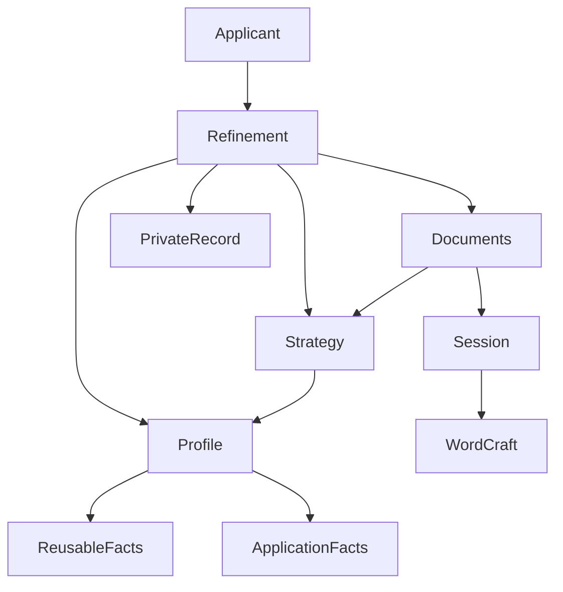
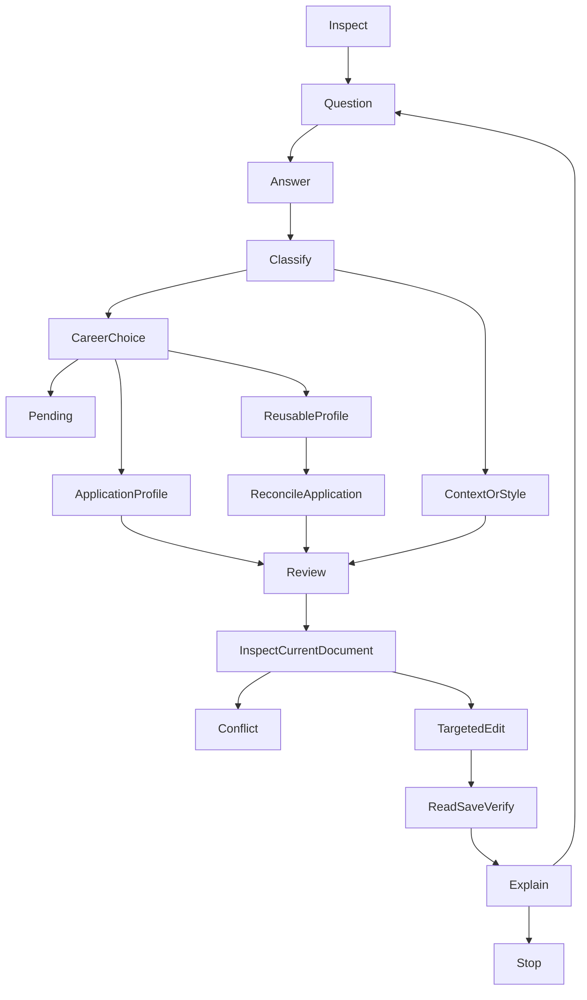

# Design: Live application refinement

## Overview

The applicant answers focused questions and watches the selected CVs and letters improve in WordCraft. Each new career fact has an explicit scope: this application only, or this application plus the reusable profile. Related contributions retain their chronology, and manual edits remain visible throughout review.

The host follows skill instructions and uses existing profile, strategy and document capabilities. A private refinement record holds conversational progress and references to their evidence. It is not a separate workflow service or a second document-operation journal.

### Goals

- Turn answers into supported, selective wording in the same live documents.
- Preserve applicant choices, manual work and honest diagnostic comparisons across interruptions.
- Enforce application-only evidence scope without weakening career-evidence validation.

### Non-Goals

New ATS formulas, model API calls, another authoring engine, automatic submissions, release publication and legacy retirement. Runtime implementation and live acceptance follow design and task approval.

## Boundary Commitments

### This Spec Owns

- Conversation sequencing, per-statement scope decisions, private refinement history and coordinated member outcomes.
- A minimal extension of the profile capability for a marked application-local profile, including verified creation and application-scoped updates.
- The corresponding strategy binding and document-consumer integration. Existing owners retain responsibility: profile validates facts, strategy grants claim eligibility and compares diagnostics, documents compose and verify content, session controls actual WordCraft operations.
- Entry-point guidance and fictional integration acceptance for the complete loop.

### Out of Boundary

Refinement never implements native WordCraft operations, changes rubric definitions, grants semantic support from a schema pass, or treats saved approval records as authority. Application context remains limited to application metadata and intent. It cannot carry career qualifications. The reusable profile's 2.0 shape and existing blank template remain valid.

### Allowed Dependencies

Dependency direction is profile contracts -> strategy -> document composition; document-session operations are a separate dependency of composition. Refinement consumes all four. Profile scope checks accept neutral application identity and target fingerprints from the host; profile does not import strategy or document code. Deterministic helpers may validate closed records and references, but do not choose wording, dispatch tools or call models.

Use the existing host file tools, pinned schema validator, pnpm test tooling and desktop-connected WordCraft MCP. No new library, service, database or custom MCP bridge is introduced.

### Revalidation Triggers

- Adding profile 2.1 scope and creation behavior requires profile intake, validation, persistence, migration and isolation regression checks.
- Strategy 1.2 binding changes require source eligibility, question disposition, comparison and document-consumer revalidation.
- Document manifests 1.2 require current acceptance adapters and asset inventories to be updated. Historical 1.0 and 1.1 evidence remains historical.
- Changes to source scope, target identity or authorization affect resume, mixed-scope updates and application isolation acceptance.
- M5 must include the new assets and validate the installed workflow; the published alpha remains the earlier implementation.

## Architecture

### Existing Architecture Analysis

Current strategy 1.1 accepts career facts only after confirmed persistence to the selected profile. Its application ID may be null when no application context is selected. Document manifests 1.1 bind directly to strategy and cannot use check-only refresh for changed wording or facts. Document-session 1.0 already handles intent persistence, identity, uncertainty and reconciliation.

### Architecture Pattern & Boundary Map

Use a fully validated application-local profile when application-only facts first become necessary. It has the same active career records and evidence pointers as a reusable profile, plus an inseparable scope marker. This avoids a new evidence namespace or an overlay merge engine.



An application-local profile is authoritative career evidence only for its selected application. The reusable profile remains the source for future applications. A path, candidate name or matching record ID cannot establish continuity or permission.

### Technology Stack

| Layer | Choice / Version | Role | Change |
| --- | --- | --- | --- |
| Host instructions | Markdown skill and references | Conversation and semantic judgment | Add refinement entry and protocol |
| Private data | JSON Schema 2020-12 | Closed facts, binding and session records | Add profile 2.1, strategy/documents 1.2, refinement 1.0 |
| Validation | Existing check-jsonschema 0.38.2 through uvx | Exact-instance schema checks | Reuse existing adapter |
| Local tooling | Existing Node and pnpm | Pure helpers and fictional tests | No service or model endpoint |
| Documents | Existing desktop WordCraft MCP | Author, inspect, render, save and reopen | Reuse discovered operations and session 1.0 |

## File Structure Plan

Paths below are repository-relative. New runtime resources stay inside the skill; all instances and acceptance receipts stay in ignored private output locations.

| Path | Action | Responsibility |
| --- | --- | --- |
| `skills/targeted-cv/references/application-refinement.md` | Create | Host conversation flow and owner handoffs |
| `skills/targeted-cv/references/refinement-session.md` | Create | Private record integrity, state transitions and resume checklist |
| `skills/targeted-cv/schemas/refinement-session.schema.json` | Create | Closed refinement record 1.0 |
| `skills/targeted-cv/schemas/cv-facts-application.schema.json` | Create | Complete profile 2.1 with mandatory application scope |
| `skills/targeted-cv/references/profile-contract.md` | Modify | Exact 2.1 dispatch and compatible evidence resolution |
| `skills/targeted-cv/references/profile-validation.md` | Modify | Scope validation and provenance checks |
| `skills/targeted-cv/references/candidate-profile.md` | Modify | Scoped selection and private fork entry |
| `skills/targeted-cv/references/profile-updates.md` | Modify | Verified fork creation and scoped updates; preserve reusable guarantees |
| `skills/targeted-cv/schemas/application-strategy.schema.json` | Modify | Current strategy 1.2 with application identity for every target |
| `skills/targeted-cv/schemas/application-strategy-v1.1.schema.json` | Create | Preserved historical 1.1 schema |
| `skills/targeted-cv/references/strategy-contract.md` | Modify | Scope-aware bindings and exact version dispatch |
| `skills/targeted-cv/references/application-strategy.md` | Modify | Scoped update integration and disposition reassessment |
| `skills/targeted-cv/references/strategy-evidence.md` | Modify | Pending career answers route to chosen profile scope |
| `skills/targeted-cv/references/strategy-review.md` | Modify | Scope-aware identity and observed-update comparison |
| `skills/targeted-cv/schemas/application-documents.schema.json` | Modify | Current manifest 1.2 binds strategy 1.2 |
| `skills/targeted-cv/schemas/application-documents-v1.1.schema.json` | Create | Preserved 1.1 manifest pinned to historical strategy 1.1 |
| `skills/targeted-cv/references/application-documents.md` | Modify | Recomposition after scope changes and same-document refinement handoff |
| `skills/targeted-cv/SKILL.md` | Modify | Route ongoing conversation to refinement |
| `docs/application-workflow.md` | Modify | User choices, live changes and resume instructions |
| `tests/live-application-refinement/fixtures.json` | Create | Wholly fictional profiles, answers and target scenarios |
| `tests/live-application-refinement/scenarios.md` | Create | Requirement-to-scenario map and live/manual steps |
| `tests/live-application-refinement/contracts.test.cjs` | Create | Closed records, scope and reference integrity |
| `tests/live-application-refinement/integration.test.cjs` | Create | Choice routing, source updates, dispositions and diagnostics |
| `tests/live-application-refinement/resume.test.cjs` | Create | Resume, stale data, uncertainty and stop cases |
| `tests/live-application-refinement/acceptance-live.cjs` | Create | Optional session helper for collecting actual MCP observations |
| `tests/live-application-refinement/acceptance-check.cjs` | Create | Check independent receipts against current inputs and runtime hashes |
| `tests/live-application-refinement/acceptance.test.cjs` | Create | Missing, altered and stale receipt rejection |
| `tests/live-application-refinement/acceptance-manifest.json` | Create | Exact runtime/test inventory for relocation |
| `tests/live-application-refinement/full-acceptance.cjs` | Create | Run offline cases and require explicit live evidence for final acceptance |

Extend the existing focused tests in `tests/portable-candidate-profile/`, `tests/targeted-application-strategy/` and `tests/wordcraft-application-documents/` for the modified contracts; retain old fixtures as historical. Update the strategy foundation and full-acceptance inventories and the document acceptance manifest for their changed assets. Session 1.0 schemas and native-operation instructions remain unchanged. Do not edit release versioning or published assets during M4.

## System Flows



The applicant can stop at any stage. Stop prevents new mutations and questions; an operation already dispatched is inspected and reconciled without replay. Unaffected requested documents can progress when one member is pending, after safe switching.

## Components and Interfaces

These are responsibilities of existing host capabilities and two new instruction references, not new deployed services.

| Component | Intent | Coverage | Dependencies | Contracts |
| --- | --- | --- | --- | --- |
| RefinementFlow | Orient, ask, classify and explain | 1, 2, 3, 6, 7 | Profile, strategy, documents, record: outbound P0 | Host protocol |
| ScopedProfile | Validate and persist selected career facts within chosen scope | 1.6, 3.1 through 3.13, 7.2, 7.3 | Existing profile contracts: outbound P0 | File and decision contracts |
| StrategyIntegration | Bind scoped sources, review claims, retain dispositions and compare | 1, 2, 3, 5, 6 | ScopedProfile: outbound P0 | Strategy 1.2 |
| LiveRevision | Refine and verify requested members through existing owners | 3.10, 4, 5, 7.4, 7.5 | Strategy, documents, session: outbound P0; WordCraft: external P0 | Manifest 1.2, session 1.0 |
| RefinementRecord | Retain private progress without recreating owner authority | 3, 6, 7 | Independently observed owner artifacts: inbound P0 | Refinement 1.0 |

### RefinementFlow

The host identifies the selected application and current document statuses, then uses existing strategy question planning. Default batch size is three; explicit limits remain one through five. Existing priorities and stable `distinction_key` values apply across both career and application questions. Ask about the missing distinction and explain its consequence; qualitative outcomes are valid evidence. Do not demand dates or metrics merely to fill blanks.

Each answer is split into independently meaningful statements with source references and uncertainty. A statement may be career evidence, application context, style, a hypothetical, or unresolved. Mixed answers do not inherit one blanket permission. Additions retain existing facts; corrections retain conflicting accounts and provenance. Later capabilities do not inherit earlier dates or responsibility. If that distinction affects proposed wording, ask the focused follow-up before claiming it.

The host offers the two usage choices against exact statements. An existing explicit choice that covers the unchanged proposal is sufficient. No response means pending. Style edits use existing facts; application metadata follows strategy context confirmation. A reusable choice requires the existing exact profile-update decision. Choosing application-only also authorizes the exact private application profile operation, not a reusable write.

`begin(selection) -> oriented | needs_input`; `interpret(answer, currentSelection) -> statements`; `route(statements, choices) -> pending | scoped_updates | context_updates | editorial`; `report(currentObservations) -> memberResults + diagnostics`. These are named instruction steps; their inputs are closed records defined below. They are not a required JavaScript orchestrator.

### ScopedProfile

Keep `cv-facts.schema.json` as the exact reusable 2.0 validator. Add profile 2.1 in `cv-facts-application.schema.json`, with all 2.0 active records, history and validation rules plus `application_scope`. Its authorization-history enum additionally permits `application_fork` and `application_fact_update`; copied historical 2.0 entries remain intact and cannot authorize new writes. The new schema has a closed root and its own complete definitions; it cannot use an `allOf` that the closed 2.0 root would reject. Structural parity tests cover unchanged fields. Existing blank intake stays 2.0. Existing 1.0 migration remains an explicitly authorized route to reusable 2.0 before forking.

```typescript
type Hash = string; // Runtime: exactly 64 hexadecimal SHA-256 characters.
type ProfileVersion = '2.0' | '2.1';
type SourceRef = { resolved_path: string; sha256: Hash };
type ApplicationSelection = {
  application_id: string;
  target_sha256: Hash;
};
type ApplicationScope = ApplicationSelection & {
  origin_profile: SourceRef & { schema_version: '2.0' };
};
type FactUse = 'application_only' | 'application_and_reusable' | 'pending';
type WriteResult =
  | { status: 'confirmed'; destination: SourceRef; version: ProfileVersion }
  | { status: 'conflict' | 'unconfirmed' | 'rejected'; reason: string; next_action: string };
```

Paths and hashes above are private instance values. `application_scope` is immutable for the lifetime of a 2.1 profile. Its origin describes creation, not a promise that the reusable file is still unchanged. Every intake and strategy binding checks the scope against the independently selected application and exact target fingerprint. Changing an offer or role fingerprint requires renewed scope selection: create a new scoped profile from the selected reusable base and explicitly chosen carried-over facts. Do not remove the marker or silently reinterpret the old application.

**First application-only fact.** `prepareFork(baseSelection, applicationSelection, destination, proposedProfile, statementChoices)` presents the exact source baseline, private destination, complete proposed profile and selected facts. The proposal preserves IDs, source records, history and unknowns, adds properly sourced new evidence, and changes only the version, required scope marker and authorized fact updates. Validate the complete 2.1 result before creation. `persistFork(exactPreparedDecision)` requires current host-observed scope authority, exclusive destination creation and private access checks. It never overwrites an existing destination. Create in a new, task-owned private directory using exclusive file creation, flush and close, reopen and verify exact bytes, access protections and full validation. Retain the exact reusable source bytes privately and verify its hash did not change. A partial or uncertain create is unconfirmed; inspect that exact file before another attempt. No implicit adoption of an existing file or wildcard cleanup is permitted.

**Existing application profile.** Extend profile update preparation with `scope: 'application_fact_update'` as a distinct decision from `fact_update`. It requires a selected 2.1 profile with matching immutable scope. Use the existing baseline, private backup, exclusive writer, security-preserving replacement, read-back and validation guarantees. Missing guarantees defer the write. Authorizations are scoped to exact proposed bytes, destination and application; an application decision cannot authorize a reusable write.

**Reusable choice.** If no application profile exists, use the existing 2.0 update route and rebind strategy. If one exists, select and validate the reusable base separately, propose only the chosen statements against that current base, and persist under its normal authorization. Never copy the complete application profile back. Then reconcile only the confirmed changes into the selected application profile, preserving local-only records and conflicts. Both destinations are named in the original choice; unchanged covered permission is reused. The writes are sequential, not atomic. If the base succeeds and the application write fails, report both outcomes and retain a pending reconciliation. Do not claim the document was updated.

**Mixed choices and concurrent edits.** Process reusable groups first, then the application profile's reviewed combined proposal. Fresh baselines are required at both steps. ID collisions, contradictory changes and externally changed source bytes require a new reviewed reconciliation; there is no automatic three-way merge. A pending group does not block unrelated supported claims. Promotion of an earlier local fact follows the same selected-statements route, never a scope-marker removal.

### StrategyIntegration

Strategy 1.2 makes `binding.application_id` non-null for every application, including role-only CVs. The host establishes an opaque application ID independently of career and offer text. `application_context_sha256` may remain null; when context exists its application ID must match. Bindings accept profile schema versions 2.0 and 2.1. For 2.1, `current()` checks both profile bytes and immutable application scope after asynchronous operations. Unknown versions and mismatched scope fail before claim support or diagnostics.

Career `EvidenceRef` remains unchanged. Its pointers resolve only to active validated records in the selected profile. A scoped profile is the selected canonical career source for that application, but it is never described to the applicant as their reusable profile. Origin paths, archive values, scope metadata and saved authorization records are ineligible support for career claims. No second namespace or qualifier shortcut is added.

Initial fork and arbitrary reselection invalidate old reasoning and produce a non-comparable baseline. Reassemble claims, language drafts and manifests from current sources; keep existing WordCraft documents for later targeted edits. Later verified updates to the same scoped profile can use the existing observed persistence/reselection comparison chain, extended to `application_fact_update` and checking unchanged application scope. A directly observed chain is required; a saved receipt cannot manufacture continuity.

Retain question dispositions separately by semantic distinction. After a fork or resume, the host rechecks each prior disposition against the freshly validated source/target and actual private interaction history. Carry forward answered, skipped, not-applicable and confirmed-gap dispositions only with a current semantic reassessment reason. A former pending answer is answered only after its selected source has confirmed persistence and its meaning has been reviewed. Rebuild evidence references and mappings; never copy old support flags. Changed requirements, conflicts and freshness reopen only the relevant distinction. If history cannot be authenticated as the selected session's history, it supplies no permission and the user resolves the disposition before it is treated as confirmed.

Use existing rubric definitions and arithmetic. A changed proposition/population can make claim support non-comparable even when offer coverage remains comparable. Report null deltas with reasons across a fork, target change, restart without a directly observed chain or incompatible comparison rows. Show before/after assessments without claiming numerical improvement. New evidence, clearer wording, unchanged scores and lower scores are all valid outcomes.

### LiveRevision

New document manifests use 1.2 and strategy 1.2 bindings. Preserve historical 1.1 validators, with the historical manifest's schema reference pinned to the archived strategy schema; leave historical 1.0 validators untouched. Normal recomposition is required after any fact, scope, context or wording change. Check-only refresh remains limited to check observations.

After recomposition, create a new manifest revision linked privately to its predecessor and retain each selected document's logical session identity and saved destination. The new revision's origin strategy hash identifies its newly reviewed composition; the retained predecessor preserves the earlier origin. Do not rewrite the previous manifest's origin or transplant old verified checks. Resolve the actual document through fresh session inspection before attaching it to the new revision.

For each affected member: read current text/structure and available formatting, compare with the last observed baseline, determine uniquely resolved targets, and preserve unrelated manual changes. Overlapping content, affected formatting or ambiguous ranges pause that member with a concise before/current/proposed conflict. Use the applicant's resolution to form a fresh baseline and supported revision. Manual factual changes remain visible but block verified delivery until supported, bounded or removed by the applicant's decision.

Rebuild the full factual inventory and Unicode code-point mappings for actual preserved text, including manual additions. Read the complete composed document for implied authority, causality, chronology and unsupported strengthening. Native targets always come from current inspection, not private anchors. The document-session owner persists intent before dispatch and owns reconciliation. Refinement stores intent references only. No new retry or rollback logic is added.

Open or raise the selected desktop once at authoring start and identify switches. Respect subsequent user focus changes. When controls cannot do so, report the specific missing action once and keep work pending. Read, save, reopen and inspect the current artifact through WordCraft; run applicable reading-order, all-page render, pagination and letter checks. Retain distinct CV/letter/language paths. A failed or unassessed member may be returned as a draft with limits; only current verified members are delivered. A requested single-member change can leave others pending for factual inconsistency, which must remain visible.

### RefinementRecord

Add a closed `refinement-session/1.0` record and an embedded deterministic `inspectRefinement` function in `references/refinement-session.md`, following the existing reference-helper pattern. The helper consumes independently validated owner artifacts; matching hashes alone do not establish semantic or operational truth.

```typescript
type MemberStatus = 'pending' | 'needs_revision' | 'editing' | 'uncertain' | 'verified';
type ArtifactRef = SourceRef;
type MemberKey = { kind: 'cv' | 'cover_letter'; language: 'en' | 'de' };
type RevisionMember = MemberKey & {
  manifest_document_id: string;
  logical_document_id: string | null;
  intent_ids: string[];
  receipt_refs: ArtifactRef[];
  status: MemberStatus;
  next_action: string | null;
};
type IntegrityResult =
  | { state: 'passed'; findings: [] }
  | { state: 'failed' | 'not_assessed'; findings: string[] };
```

The record's `inspectRefinement(record, previousObservedRecord, currentOwnerObservations) -> IntegrityResult` checks closed shape, references, valid transitions and scope consistency. `previousObservedRecord` is null only at initial creation; otherwise the host supplies the independently retained exact previous record and hash, not a predecessor asserted by the new record. On resume, first validate the saved record as historical data; without a trustworthy predecessor, report transition continuity as not assessed and establish a new inspected baseline. Never replay stored transitions to fill that gap.

`checkpoint(record, expectedPreviousHash, privateDestination)` is a host instruction using verified private file writes, not a model/tool dispatcher. It returns a confirmed artifact reference or an unresolved outcome. A failed checkpoint before a new operation blocks that operation; a failed checkpoint after dispatch routes to the owner reconciliation and cannot justify a retry.

#### Record transitions and guards

The record reflects owner observations; it cannot initiate or authorize a state transition by itself. A new member starts `pending` or `needs_revision`. A freshly observed existing artifact may start `verified` only with current passing owner evidence.

| Transition | Required observation or decision |
| --- | --- |
| `pending` to `needs_revision` | Missing input resolved; current supported composition and target selection available |
| `needs_revision` to `editing` | Fresh document identity/baseline, authorized bounded change and verified persisted session intent |
| `editing` to `uncertain` | Session reports dispatched ambiguity or interruption without a confirmed effect |
| `editing` to `needs_revision` | Known no-dispatch failure, current conflict or a confirmed edit with failed/unassessed verification |
| `editing` to `verified` | Confirmed effect, current supported inventory and all mandatory document checks passed |
| `uncertain` to `verified` or `needs_revision` | Existing session reconciliation conclusively identifies the effect; fresh support and check results determine the destination |
| `verified` to `needs_revision` or `pending` | Source/manual-content change invalidates checks, or a required source/input becomes unavailable |
| `needs_revision` to `pending` | Current input/selection readiness is lost; no unconfirmed dispatch exists |

Same-state checkpoints retain new observations without granting new authority. An uncertain member cannot return directly to `editing` or become `pending` to evade reconciliation. A transition to `verified` always consumes current owner evidence, including when resuming or manually repairing a draft. Unlisted transitions fail integrity review and require reconciliation rather than an automatic state reset.

Session `stop_state` starts `active`. It changes to `paused`, `accepted`, `declined` or `exhausted` only after the corresponding user request or documented exhaustion assessment. These states block new question batches and mutations. Only an explicit user continuation request can return a stopped session to `active`, after fresh selection and unresolved-operation inspection. Read-only reconciliation remains allowed while stopped. Question dispositions and profile-operation results follow their existing owner transition rules; the wrapper validates references and never rewrites them to manufacture progress.

## Data Models

### Domain Model

One refinement session belongs to one independently selected application. It references one selected career profile at a time, optionally a separate reusable base, one selected target/settings/context set, and a collection of requested document members. Statements and choices have stable private IDs. A revision is a plan and a collection of per-member outcomes; it is not an atomic transaction across profiles and documents.

### Logical Data Model

All fields are required by the new schema, with explicit nulls for not-yet-observed references. Closed objects reject unknown fields. No executable command or serialized tool invocation is stored.

| Field | Shape and invariant |
| --- | --- |
| `schema_version`, `session_id`, `application_id` | Fixed 1.0 and nonempty private IDs; application agrees with current binding |
| `selection` | Active profile ref/version, reusable base ref or null, target hash, settings hash, context ref or null; observations, not authorization |
| `owner_artifacts` | Strategy, document manifest and document-session artifact refs or null; latest valid refs plus retained predecessor refs |
| `questions` | Stable distinction key, question ID, disposition, related statement IDs, reassessment/reopen reason or null; one current disposition per distinction |
| `statements` | ID, source turn reference, supplied text, meaning classification, uncertainty, related claims/questions and temporal qualifiers; candidate values private |
| `choices` | Statement IDs, fact-use choice, exact proposal digest, named destinations, historical decision reference; scope may not silently expand |
| `profile_operations` | Proposal/result artifact references and affected statement IDs, destination role and confirmed/unresolved status; no duplicated persistence authority |
| `revisions` | Revision ID, source baselines, affected claim IDs, predecessor manifest ref, member outcomes and current verification refs |
| `comparisons` | Before/after review refs, row-level comparability and reasons supplied by strategy |
| `stop_state` | `active`, `paused`, `accepted`, `declined`, `exhausted`; reason, pending-operation refs, last confirmed deliverables |

### Consistency, Privacy and Resume

Store all instances under an explicitly selected ignored application directory or authorized private external location. Resolve and check paths before writes; preserve existing privacy and access controls. Schema validation, read-back and expected-baseline comparison precede reporting a checkpoint saved. Only the host writes during the session; if exclusive safe writing cannot be established, retain state privately in memory and report that persisted resume is unavailable. Do not claim interruption recovery is durable until a verified checkpoint exists.

On resume, validate the record as historical data, select the current source files and application independently, revalidate their versions and scope, and establish current context confirmations. Reconnect and inspect each needed WordCraft document through its existing identity/recovery protocol. Reconcile incomplete profile creates/replacements and document intents before new writes. No stored `verified`, authorization or ready flag survives as present authority. Reassess dispositions and reports against current sources. A missing source or unknown identity pauses only work that depends on it.

On stop, cease new questions and dispatches. Inspect already-dispatched operations when possible and report uncertainty otherwise. Record the last confirmed deliverables, whether the reusable profile changed, and pending member outcomes. User acceptance does not turn missing verification into a pass. Exhausted questions end the loop without pursuing a score threshold.

## Error Handling

| Condition | Response |
| --- | --- |
| Unknown profile/version or failed validation | Route to supported intake/repair; no new support claims |
| Scoped profile used with another application or target | Reject binding; request explicit new selection and fact-use choices |
| Ambiguous answer or missing usage choice | Retain pending statement; proceed with unrelated supported work |
| Existing fork destination or unsafe file controls | Do not overwrite; inspect identity or choose an authorized fresh destination |
| Reusable update confirmed, application reconciliation pending | Report split result; resume from observed owner outcomes |
| Stale baseline or conflicting manual edits | Show the affected conflict and await resolution before overwriting |
| Uncertain mutation or lost connection | Reconcile through the owning protocol; never replay |
| Incomplete letter or unavailable language review | Retain that member pending; continue ready members |
| Changed comparison population or missing source observation | Null delta, side-by-side values and explanation |

Diagnostics and operational records stay private. Public test output reports scenario IDs and pass/fail status, not candidate excerpts. No telemetry service is introduced.

## Requirements Traceability

| Requirement | Summary | Components | Interfaces | Flows |
| --- | --- | --- | --- | --- |
| 1.1, 1.2, 1.3 | Select and orient; role-only limits | RefinementFlow, StrategyIntegration | begin, binding 1.2 | Inspect |
| 1.4, 1.5, 1.6 | Source changes and member readiness | ScopedProfile, StrategyIntegration, LiveRevision | scope guard, normal composition | Review |
| 2.1, 2.2, 2.3, 2.4 | Prioritized useful questions | RefinementFlow, StrategyIntegration | existing question planner | Question |
| 2.5, 2.6, 2.7 | Dispositions and free answers | RefinementFlow, RefinementRecord | distinction reassessment, interpret | Answer |
| 3.1, 3.2, 3.3 | Source and classify statements | RefinementFlow, ScopedProfile | statements, meaning review | Classify |
| 3.4, 3.5, 3.6 | Per-fact scope and persistence | ScopedProfile | prepareFork, scoped/reusable update | CareerChoice |
| 3.7, 3.8, 3.13 | Exact authority or pending | ScopedProfile, RefinementRecord | choices, owner decisions | Pending |
| 3.9, 3.11, 3.12 | Corrections, additions and chronology | ScopedProfile, StrategyIntegration | ordinary records, semantic review | Review |
| 3.10 | Manual factual support | LiveRevision, StrategyIntegration | full factual inventory | InspectCurrentDocument |
| 4.1, 4.2, 4.9 | Visible desktop and focus | LiveRevision | existing session capability checks | TargetedEdit |
| 4.3, 4.4, 4.5 | Inspect, preserve and resolve | LiveRevision | current snapshot and targeted edit | Conflict |
| 4.6 | Selective contribution wording | RefinementFlow, StrategyIntegration | composition and editorial review | Review |
| 4.7, 4.8 | Uncertainty and verified save | LiveRevision | existing intent/receipt/verification | ReadSaveVerify |
| 5.1, 5.2, 5.3, 5.4 | Coordinated multilingual members | LiveRevision | revision members and semantic pair review | Review |
| 5.5, 5.6 | Layout and distinct deliverables | LiveRevision | document verification, saved artifacts | ReadSaveVerify |
| 6.1, 6.2, 6.3, 6.4 | Honest assessments and changes | StrategyIntegration | current reviews and comparisons | Explain |
| 6.5, 6.6 | Evidence limits and support | StrategyIntegration, RefinementFlow | existing rubrics and host review | Explain |
| 7.1, 7.2, 7.3, 7.4 | Private state and fresh resume | RefinementRecord, ScopedProfile, LiveRevision | checkpoint and owner recovery | Inspect |
| 7.5, 7.6, 7.7 | Stop and report | RefinementFlow, RefinementRecord | stop_state and confirmed artifacts | Stop |
| 7.8, 7.9 | Privacy and inert inputs | All components | closed records and current host authority | All flows |

## Testing Strategy

### Contract and Integration Tests

- Validate 2.0/2.1 dispatch, preserved IDs/history, immutable scope, wrong application/target rejection, active-record eligibility and unknown versions. Verify copying the 2.1 file retains its restrictions (1.6, 3.5, 7.3).
- Exercise per-statement mixed choices, pending choices, unchanged authorization reuse, exclusive fork creation, existing destination rejection, partial writes, concurrent reusable changes and promotion of only selected facts (3.1 through 3.9, 3.13).
- Exercise additive responsibility and chronology, ambiguous capability timing, unsupported manual claims and free answers. Independently review semantic cases; fixture validity alone cannot pass meaning checks (2.3, 2.4, 2.7, 3.10 through 3.12).
- Verify batch priorities, paraphrase suppression, skipped/gap states, fork/resume disposition reassessment and unsupported pending answers (2.1 through 2.7).
- Verify non-comparable initial fork, directly observed same-profile updates, changed-population null deltas, unchanged/lower scores and role-only coverage limits (1.2, 6.1 through 6.6).
- Verify full recomposition versus check-only refresh, per-language stale members, exact manifest lineage, unknown identities, forged restored approvals and failure after dispatch (1.4, 5.1 through 5.4, 7.1 through 7.4, 7.9).

### Actual WordCraft Acceptance

Use wholly fictional logistics/field-service applicants unrelated to private career data. Keep fixtures copied to an ignored private run directory. Start with independently observed English/German CV and Germany-market letter members. Retain each DOCX separately.

1. Ask a focused question, receive a sourced fictional answer, choose application-only use, persist and reselect the marked profile, and revise the same live CV and relevant letter. Prove reusable bytes unchanged and verify all affected pages (1.1, 1.3, 3.4, 3.5, 4.1 through 4.4, 4.6, 4.8, 5.5, 5.6).
2. Add unrelated manual prose and formatting, then apply a later answer. Verify preservation. Introduce an overlapping edit, demonstrate withholding, resolve it, and read back the exact supported result (3.10, 4.3 through 4.5).
3. Choose reusable persistence for one fact while keeping another local. Verify both selected sources and provenance, show a partial/pending member honestly, then complete its revision and multilingual consistency review (3.6 through 3.9, 5.1 through 5.4).
4. Interrupt the connection after an actual dispatched edit at a controlled boundary. Reconnect, inspect and reconcile without duplicate writing; separately test absent and ambiguous effects in deterministic controls. Resume against changed source bytes and reject stale authority (4.7, 7.2 through 7.4).
5. Skip a question, provide an unsolicited correction, request stop and verify no further mutations or questions are initiated. Report last confirmed files and outstanding issues. Exercise the missing-foreground-capability response as an explicitly simulated control, separately from actual visible authoring (2.5 through 2.7, 4.2, 4.9, 7.5 through 7.7).

Actual receipts bind runtime asset hashes, selected source hashes, owner records, document IDs, operation outcomes, saved DOCX hashes and inspected page render evidence. A reviewer checks both meaning and actual pages. Missing live evidence fails final acceptance; offline simulations retain their own labels. Stop/dispatch evidence comes from the host trace and owner receipts, not a test's assertion that it would stop.

### Regression, Relocation and Privacy

Run affected profile, strategy and document suites, then M4's inventory from an unrelated temporary directory using only declared assets. Historical fixtures use their pinned validators; current scenarios require 1.2. Validate archive and source exclusion through the existing privacy checks and human inspection. No real walkthrough content enters tests or reports. Preserve earlier acceptance records rather than rewriting their hashes to imply new coverage.

## Migration Strategy

Implement and review profile scope support before strategy 1.2, then document 1.2 integration, then the refinement entry and live acceptance. Current 2.0 reusable profiles need no rewrite. Existing 1.0 inputs follow their approved migration workflow. Existing 1.1 strategies/manifests are historical and must be rebuilt from fresh sources; their WordCraft documents may be rebound through current inspection and edited in place.

The scope marker is never stripped to promote facts. Initial forks and scope changes establish new diagnostic baselines. A failed rollout leaves existing files and the released alpha intact; M4 cannot be reported complete until upstream regressions and actual live acceptance pass. Release packaging changes remain with M5.
