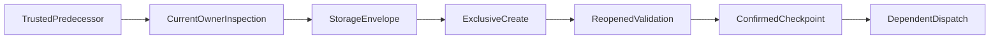

# Design amendment: versioned application and checkpoint persistence

Status: requirements and design approved. All ten prerequisite tasks are approved; implementation is authorized and current validation remains outstanding. This amendment adds explicit consumers of the Candidate Profile new-version capability and a separate checkpoint storage format.

## Boundary Commitments

### This Spec Owns

- Sequencing separately authorized reusable and application versions, current strategy/document rebinding and truthful partial outcomes.
- Versioned checkpoint storage, trusted predecessor observation and recovery under the current refinement/session rules.
- Current maintenance acceptance selection for the actual versioned files, without checkout-driver filename assumptions.

### Out of Boundary

Profile updates own creation guarantees and career validation. Strategy owns eligibility and diagnostic arithmetic. Documents and session retain composition and WordCraft operations. Refinement never replaces a native file primitive, creates a model endpoint or grants write authority from a storage record.

### Allowed Dependencies

The ProfileUpdate creation policy/lease, current profile 2.0/2.1, strategy/documents 1.2, refinement-session record 1.0, pinned local schema validation and existing WordCraft MCP. No library, daemon, database or new framework is added.

### Revalidation Triggers

New source paths, storage envelopes, predecessor witnesses and current-selection evidence require direct profile/strategy/document/session/refinement/release revalidation. New package bytes require fresh installed acceptance; old receipts remain historical.

## ScopedProfile and current bindings

Use explicit new-version preparation for supported subsequent 2.1 application updates; leave the existing fork and replacement routes unchanged. Keep immutable application identity, target fingerprint and original-profile reference. Preserve local-only records, unresolved conflicts and chronology.

For a reusable choice, create only the selected changes against the independently current reusable source and explicitly select/validate the confirmed successor when that effect was authorized. Then prepare the application's separately reviewed successor, preserving its immutable original scope. The writes remain sequential, not atomic. Retain confirmed reusable success when the application step fails; never replay it or copy an entire local profile back.

Fresh source selection invalidates old claims and manifests. Reassemble current reasoning and supported wording. Extend the existing live observed-update producer to recognize an exact owned source-to-successor operation: source path/hash must match the prior binding, current path/hash the confirmed destination, with current validation, unchanged logical candidate/application and directly observed selection continuity. Stored receipts alone cannot mint this proof. If that chain or rubric/population comparability is unavailable, establish a fresh baseline and report no numerical delta.

The existing strategy 1.2 and document 1.2 shapes remain unchanged. A changed path is not itself candidate identity proof. Recomposition uses current facts and new bindings; targeted WordCraft edits preserve document identities, unrelated manual text and formatting. No saved verified checks transfer to a new source.

## VersionedCheckpointStorage

Keep the raw refinement-session 1.0 schema and legacy checkpoint factory unchanged. Add a distinct `createVersionedRefinementCheckpoint(host)` factory and one closed private storage schema. The new factory creates one new storage file per confirmed checkpoint; it never overwrites a previous checkpoint or a latest-pointer file.

### Storage format

| Field | Constraint |
| --- | --- |
| `schema_version` | Exactly `1.0` for this separate storage contract |
| `kind` | Exactly `refinement-checkpoint-storage` |
| `previous` | Null for an inspected fresh chain baseline, otherwise exact `{resolved_path, sha256}` of the independently trusted predecessor storage artifact |
| `record_utf8_base64` | The actual retained UTF-8 byte payload of a refinement-session 1.0 record; encoding is not encryption |
| `record_sha256` | SHA-256 of decoded payload bytes, independent of the outer storage-file hash |

Validate the closed wrapper, strictly decode canonical base64 and UTF-8 and hash its actual payload, parse inert JSON, then run the unchanged 1.0 record validator and owner inspection. Never rely on a content-schema annotation to validate JSON hidden inside a string. Reject malformed encoding, digest mismatch, unsupported body versions and unknown wrapper properties. Instances and all decoded content remain private.

### Observation and checkpoint interfaces

The factory exposes read-only `observe(selectedRef)`, `prepare(record, observedPredecessor, destination)` and `persist(capability)`. Observation verifies selected raw bytes/hash, type, source identity and complete record validation. It returns a live, nonserializable witness containing the outer artifact reference, exact retained record payload, its digest and parsed record. Keep its authoritative snapshot in the factory's private registry; mutation, cloning or another factory's witness fails. A directly inspected legacy raw 1.0 checkpoint is also a permitted predecessor; in that case the payload and storage hashes coincide.

For the transition inspector, pass the retained prior record and its payload digest, with a mode-specific `hashRecord` adapter that proves the exact retained payload parses to that record. This payload witness is authenticated by the separately checked outer artifact hash. Never return an outer wrapper hash as if it hashed a raw inner record, and never fabricate prior checkpoint bytes by reserializing an object. The legacy inspector mechanics and legacy raw-file hash adapter remain unchanged; document the new factory's extracted-payload contract explicitly.

Preparation checks current owner observations, authorized workspace and the exact trusted predecessor, builds the wrapper once and retains its exact bytes in a live capability. It does not write. Persistence calls the shared `host.acquireCreate({source, destination, policy_id, phase})`, with create phase before the first attempt and read-only inspect phase afterward. Source is the predecessor's outer artifact ref, or null for an inspected initial baseline. A fresh-chain null predecessor is allowed only after complete current baseline inspection. It cannot clear pending operations, convert uncertain members to pending, revive a stopped session or manufacture continuity.

Checkpoint destinations are chosen within the already authorized private session workspace. No per-filename applicant prompt is introduced. The host advances its current reference only after exact reopened wrapper bytes, payload/record validation, source continuity and creation-policy confirmation. Return both the actual storage reference and observed record identity; dependent dispatch consumes confirmed storage, not an unconfirmed file's presence.

## Recovery and stopping

Mark a create attempted before dispatch. Uncertain or repeated invocation only inspects the exact planned destination; no replay, cleanup or overwrite. A failure before a dependent WordCraft operation blocks that operation. A failure after an operation routes to its existing owner reconciliation.

On resume, select an exact storage reference rather than scanning filenames. A stored `previous` field is data, not independent predecessor authority. Without trustworthy transition history, validate the historical record, inspect actual current owners and explicitly establish a fresh baseline with continuity unassessed. Carry forward unresolved intents and stopped restrictions; a fresh filename never resets them. Only current actual user instructions can authorize resumption, and a stop observation grants no other mutation.

## Current acceptance and compatibility

The existing `m4-evidence-index` has no schema version and uses legacy sibling filenames. Retain that historical branch. Add a distinct closed `kind: m4-versioned-evidence-index`, `schema_version: 1.0` with the following required fields:

| Field | Contract |
| --- | --- |
| `inputs` | Exactly the existing six independently selected receipt/review/control paths: previousReceipt, previousReview, currentReceipt, currentReview, recoveryReceipt and controls |
| `input_selections` | Closed keys reusable_profile, application_profile, checkpoint, strategy, manifest, final_report and checkpoint_chain; each ref has resolved_path and sha256, and the chain is an ordered ref array |
| `roots` | Explicit unique evidence or selected installed-resource directories; no fixed four-directory assumption |
| `references` | Derived reference-membership closure within selected roots, including refs inside decoded, validated checkpoint payloads |
| `files` | Complete exact root inventory of path and sha256 rows |

`input_selections.application_profile` can be the explicitly selected 2.0 source before a fork or scoped 2.1 afterward; the actual record and current application bindings decide eligibility. The checkpoint ref selects the new storage type. Its chain lists the independently selected predecessors oldest first, excluding current; a legacy raw predecessor is permitted. Require exact previous links and no duplicate/cyclic members. Verify all source/hash associations against the current record and owner inputs. Enumeration establishes inventory only; it never chooses a latest version or imports an unselected root.

Keep the public normalized `SHA256(JSON.stringify(index))` digest argument. Also pin exact index-file bytes in a closed review with schema_version 1.0, kind m4-versioned-selection-review, nonempty reviewer and observation strings, selected_index, index_file_sha256, normalized_index_sha256, exact input_selections, selected_roots_reviewed true and integer file_hashes_reviewed/reference_membership_reviewed counts. Counts must match actual reviewed files. The operator authenticates the reviewer and selected digest outside these records; an attestation alone grants no authority.

Create the index and review outside the frozen inventoried roots to avoid self-hash cycles. Subsequent validation writes its reports and temporary test data elsewhere. Recheck complete inventory and digests after validation; never modify the selected evidence or reinterpret an embedded source path as permission to read another directory.

The current verifier unwraps the selected storage artifact before applying existing record binding checks. Do not copy versions to `application.json` or `refinement-checkpoint.json` aliases to satisfy legacy tests.

Retain the legacy index/retained-report/recovery verifier paths for historical evidence. Current versioned acceptance selects exact ordered checkpoint references, not backup-filename enumeration. The full validator's public index/digest/review entrypoint remains; it dispatches the closed index version explicitly. M5 can therefore invoke the same owner entrypoint while supplying current installed evidence. Hashes and an index version never establish semantic truth or write authority.

## File Structure Plan

| Files | Responsibility |
| --- | --- |
| `skills/targeted-cv/references/application-refinement.md`, `candidate-profile.md` | Choice sequencing, source selection and truthful partial results |
| `skills/targeted-cv/references/refinement-session.md` | New storage factory, payload witness, create/reconcile/resume guards; retain legacy factory |
| `skills/targeted-cv/schemas/refinement-checkpoint-storage.schema.json` | New closed outer storage shape; raw session 1.0 schema remains unchanged |
| `skills/targeted-cv/references/strategy-review.md`, `strategy-contract.md` | Existing-owner observed-update integration and current path/hash bindings; no new scoring/schema |
| `tests/live-application-refinement/scoped-profile.test.cjs`, `scoped-persistence.test.cjs`, `selective-promotion.test.cjs`, `refinement-record.test.cjs`, `resume.test.cjs`, `strategy-continuity.test.cjs` | Extend existing suites for new profiles, storage and consumer behavior |
| `tests/live-application-refinement/acceptance-check.cjs`, `full-acceptance.cjs`, `foundation.cjs`, `acceptance-manifest.json` | Explicit current-index selections, storage decoding, complete criteria and resource closure |
| `tests/live-application-refinement/evidence-index.schema.json` | New closed current index/review contracts; maintenance-only, not bundled runtime |
| `tests/live-application-refinement/recovery-evidence.cjs`, `refinement-report-retained.cjs` and existing corresponding tests | Separate current selection dispatch from retained historical filename behavior |
| `skills/targeted-cv/SKILL.md`, `docs/application-workflow.md` | Session behavior and ordinary-user version choice, without technical checkpoint prompts |
| `release/manifest.json`, `release/rights.json`, `release/candidate.json`, `release/candidate.schema.json`, `release/candidate-definition.cjs`, `tests/portable-skill-release/manifest.json`, `tests/portable-skill-release/foundation.cjs` | Release-owned integration: include/hash the added schema and changed resources, declare checkpoint-storage 1.0 and validate the current closure |

Release integration adds `refinement_checkpoint_storage: ["1.0"]` to current contract declarations and metadata, without creating a new application capability or rewriting historical artifacts. Update exact inventory and authorized rights hashes only after owner validation; preservation review covers the approved additive changes and retained legacy behavior. Old artifacts retain their independently selected prepared verifiers. Preserve historical schemas and validators. Do not publish or modify a sibling catalog during this amendment.

## Requirements Traceability and Testing

| Requirement | Design and acceptance evidence |
| --- | --- |
| 8.1 | Immutable 2.1 successor scope, selected-only promotion and separate partial outcomes |
| 8.2 | Live predecessor witness, exact payload versus outer hashes, confirmed create before dispatch, no latest scan |
| 8.3 | Existing stop/uncertainty guards across storage changes and failed creates |

Test legacy and new storage together without widening legacy validators. Include changed predecessor bytes, foreign source/application, forged witnesses, incorrect payload hashes, invalid inner records, ambiguous/missing history, partial creates, interrupted post-dispatch checkpoint and explicit stop. Observe an actual ordinary-user reusable and local choice, native checkpoint sequence and no-replay recovery. Review all selected bilingual documents through WordCraft and rerun the two-applicant installed acceptance on a newly built artifact.
