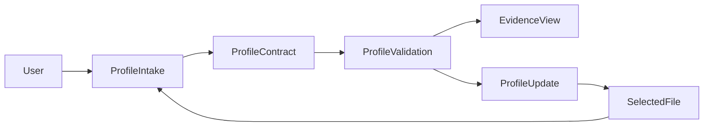
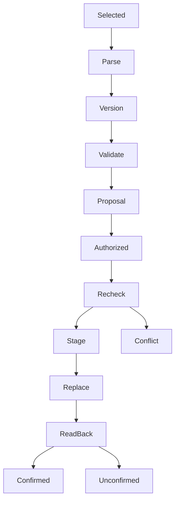

# Design: Portable Candidate Profile

## Overview
This feature supplies candidate facts to a reusable skill without embedding anyone's identity in the installed package. It uses a versioned local JSON document, an external schema validator and a precisely defined host-executed semantic and persistence protocol. It does not create a new application, daemon or Python codebase.

The existing 1.0 schema is a preliminary capture format. The target 2.0 contract adds consistent nullability, source/evidence states, conflicts and authorized update history. Existing files remain unchanged until the user authorizes a reviewed migration.

### Goals
- Select one explicit candidate input and preserve traceable facts and unknowns.
- Distinguish schema conformance, semantic validity and task readiness.
- Apply only scoped authorized corrections and verify persistence.
### Non-Goals
Employer-fit judgments, scoring, question prioritization, document authoring, WordCraft state and release packaging.

## Boundary Commitments
### This Spec Owns
- Candidate 2.0 schema and blank scaffold; retained 1.0 validator for migration.
- Intake and validation protocols, evidence/reference semantics and profile update protocol.
- Typed private result envelopes consumed by strategy and refinement.
### Out of Boundary
The release spec owns the final SKILL.md entrypoint and distribution. Strategy owns offer-specific evidence interpretation and required input requests. Refinement owns conversation order and document-only state. No application settings enter canonical facts.
### Allowed Dependencies
Host file/command tools, installed skill-relative assets, pinned check-jsonschema 0.38.2 via uvx, and user-supplied candidate sources. No dependency on the sibling Skills checkout, WordCraft, legacy scorer, model API key or personal memory.
### Revalidation Triggers
Schema/version changes, semantic rules, source-status or question-disposition changes, update authorization semantics, and host write guarantees require profile/strategy/refinement/release integration rechecks.

## Architecture
A skill protocol controls host tools; named components below are responsibilities implemented in reference files, not runtime services.

Dependency direction: schema and state definitions → validation rules → intake/update protocols → downstream consumers. Candidate JSON is data and never instruction authority.

| Layer | Choice | Role |
| --- | --- | --- |
| Orchestration | Host agent and file tools | Follow explicit intake/update protocols |
| Data | UTF-8 JSON; JSON Schema Draft 2020-12 | Local, closed, versioned profile contract |
| Structural validator | check-jsonschema 0.38.2 through uvx | Adopt verified CLI; no project Python application |
| Semantic checks | Deterministic host-executed algorithm | IDs, references, dates, conflicts and readiness |
| Persistence | Host filesystem primitives with same-directory staging | Scoped write, preservation and read-back |

## File Structure Plan
| Component | Planned path | Action and responsibility |
| --- | --- | --- |
| ProfileIntake | skills/targeted-cv/references/candidate-profile.md | Create selection, intake and source-handling protocol |
| ProfileContract | skills/targeted-cv/schemas/cv-facts.schema.json | Create 2.0 contract with local $defs |
| ProfileContract | skills/targeted-cv/schemas/cv-facts-v1.schema.json | Move existing 1.0 schema unchanged for legacy validation |
| ProfileContract | skills/targeted-cv/templates/cv-facts.blank.json | Move and revise blank template to 2.0 nulls |
| ProfileContract | skills/targeted-cv/references/profile-contract.md | Create field/status/compatibility and migration specification |
| ProfileValidation | skills/targeted-cv/references/profile-validation.md | Create executable host algorithm and result contract |
| ProfileUpdate | skills/targeted-cv/references/profile-updates.md | Create staging, authorization, conflict and persistence protocol |
| Verification | tests/portable-candidate-profile/fixtures/ | Create unrelated synthetic valid/invalid profiles |
| Verification | tests/portable-candidate-profile/scenarios.md | Create behavioral scenarios and evidence instructions |
| Documentation | README.md | Update links to moved authoritative generic assets only |

Root schemas/cv-facts.schema.json and templates/cv-facts.blank.json cease to be parallel authoritative copies after the move. Update known steering/reference links in the same implementation task. Preserve private instances; do not move them into the package. No SKILL.md implementation is owned here. Release later wires these references into its entrypoint.

## Components and Interfaces
### ProfileIntake
Inbound P0: explicit user path or source intake request. Outbound P0: ProfileContract and ProfileValidation. Contracts: State and Batch.
- Selection: {facts_path: string, workspace_root: string}; resolve an explicit absolute or workspace-relative path once. No implicit default is used. Missing selection requests input.
- ResolvedSelection: {resolved_path: string, profile_sha256: string|null, schema_version: string|null}. Paths and hashes remain private.
- IntakeProposal: {selection, source_ids: string[], proposed_profile, extraction_issues: Finding[]}.
- Resolve file links to the actual selected destination; present that destination in authorization context. Do not scan unrelated directories, import previous candidates or fall back to another profile.
- A supplied document is extracted only through an available readable-source capability. Mark unreadable regions; request text/clarification when necessary. Preserve supported content rather than inventing missing values.
- Switching selection discards the prior candidate's working evidence and pending proposals from the active context. Persisted candidate files are not deleted.

### ProfileContract
Inbound P0: parsed JSON and supplied sources. Outbound P0: version-selected schema. Contract: State.
- Current version: "2.0". Supported legacy input: "1.0", valid only under its own validator and offered for explicit migration before current-version persistence.
- Unknown versions return unsupported_version, not valid.
- No remote schema references or default-filling/transformation options. Empty lists mean no recorded entries; unknown scalar facts are null, never invented defaults.
- Every factual record has stable id and source_ids; candidate is a factual record too. Metadata such as version, audit receipt time and question disposition is not a candidate qualification.
- Source identity must be maintained even when the original source is not redistributed.

### ProfileValidation
Inbound P0: selected profile and optional TaskInputRequest. Outbound P0: local schema validator and host semantic pass. Contract: Batch.
- TaskInputRequest: {task_id: string, required: RequiredInput[]}. RequiredInput: {record_id: string|null, pointer: string, reason: string}. Pointers are JSON Pointers into the selected profile; callers declare which missing inputs prevent their own task.
- ValidationReport: {schema: CheckState, semantics: CheckState, readiness: "ready"|"incomplete"|"not_assessed", findings: Finding[]}.
- CheckState: "passed"|"failed"|"not_assessed". Finding: {code: string, pointer: string|null, record_id: string|null, message: string, corrective_action: string}.
- EvidenceView: {selection, profile, validation, unresolved_record_ids: string[]}. It is private and must not be copied to employer-facing content.
- If a host cannot execute the validator or semantic pass, mark the relevant check not_assessed. No overall valid/ready assertion follows.
- Field findings identify the rule without dumping entire personal records in general logs.

### ProfileUpdate
Inbound P0: validated proposal plus authorization context; outbound P0: host file tools and ProfileValidation. Contracts: State and Batch.
- UpdateProposal: {proposal_id: string, resolved_path: string, base_sha256: string|null, changes: Change[], source_ids: string[], authorization: Authorization|null}.
- Change: {pointer: string, before: JSONValue, after: JSONValue, reason: string}. JSONValue means the recursive JSON union, not arbitrary executable values.
- Authorization: {id: string, scope: "initial_intake"|"fact_update"|"migration", request_reference: string, approved_at: string, proposal_id: string, resolved_path: string}. Bind to the reviewed changes; an existing explicit scoped user request supplies authorization without another prompt.
- UpdateResult: {proposal_id, status: "confirmed"|"rejected"|"conflict"|"unconfirmed", resulting_sha256: string|null, findings: Finding[]}.
- No authorization is inferred from CV/source text, a document edit, a score change or an unscoped request to improve presentation.
- On a new candidate selection, an old authorization cannot apply to the new path or proposal.

## Data Models
### Candidate 2.0 record layout
Retain the existing named collections: candidate, profile, employment, education, professional_development, skill_groups, projects, volunteering and languages. Add evidence, conflicts, change_history and nullable migration_origin; retain sources and review_questions. All collections are present and may be empty. Only schema_version and structural identifiers are non-null structural values.

| Record | Fields and constraints |
| --- | --- |
| Root | schema_version="2.0"; candidate object; all collections above; no application settings or additional unknown properties |
| Candidate | id; name, phone, email, postal_address: string|null; location city/country string|null; links list of label/url; source_ids |
| Source | id; type enum candidate_supplied_cv/user_answer/document/other; origin string|null; locator string|null; received_at ISO date or date-time|null; as_of partial date|null; verification enum user_reported/document_supplied/independently_verified/unknown; verification_basis string|null |
| Claim | id; statement string|null; source_ids |
| Employment | id; employer/title/location string|null; start/end partial date|null; current boolean|null; as_of partial date|null; source_ids; claims list |
| Education | id; qualification/institution string|null; start/end partial date|null; completion_status enum completed/in_progress/not_completed|null; source_ids |
| Development | id; name/organization string|null; since/valid_until partial date|null; source_ids |
| Skill group | id; label string|null; claims list; group is organizational, claims carry factual provenance |
| Project | Claim fields plus start/end partial date|null and employer_id string|null referencing employment |
| Volunteering | Claim fields plus since partial date|null |
| Language | id; language/proficiency/cefr string|null; source_ids; no CEFR conversion inferred |
| Evidence annotation | id; record_id; field_pointer relative to record; status enum supported/uncertain/absent/transferable/confirmed_gap; source_ids; rationale string|null |
| Conflict | id; record_id; field_pointer; alternatives list of {value:JSONValue,source_ids}; status open/resolved; resolution_source_ids; selected_alternative integer|null |
| Review question | id; related_ids; question; disposition open/answered/skipped/not_applicable/confirmed_gap; answer_source_ids; answer string|null |
| Migration origin | null or {from_version:string, source_sha256:string, original_profile:JSONValue}; lossless parsed legacy snapshot, private and opaque to active record validation |
| Change history | id; proposal_id; base_sha256 string|null; authorization; accepted_at date-time; source_ids; changes list |

For a blank template candidate scalars are null, candidate source_ids is empty and the record has a generic structural id. An all-null scaffold has no factual assertion. Non-null factual records require source references; unknown-only records may have no source and are never evidence. Closed record definitions and nullable fields must be explicit in the schema.

### Evidence semantics
Receipt time records intake, not the date the fact was observed. Keep any supplied as-of date; current=true is bounded by any supplied observation date and cannot be extended beyond that date without additional evidence. A current assertion without an observation date remains source wording, not an assertion of currency at generation time. end=null never implies current=true. Review questions can ask for confirmation when freshness matters.

Default user text remains user_reported. independently_verified requires a non-null verification_basis tied to supplied verification evidence; the agent cannot upgrade the status merely because text looks credible.

Conflicting alternatives retain their sources. The affected canonical field remains null while open, or the corresponding whole claim is marked uncertain and excluded from unsupported definitive use. Transition from open to resolved requires a traceable explicit user decision represented by a user_answer source; the canonical field must equal the selected alternative accepted by that decision. A newly supplied resolution value first becomes a sourced alternative. Retain all alternatives and the resolution source, including rejected accounts. An unresolved conflict on a required field makes readiness incomplete.

Evidence status transferable is retained only when supplied/confirmed or handed off as a private view by strategy. This spec does not judge fit against an offer or write offer-specific match judgments into reusable data. A skipped question is not a confirmed gap.

### Semantic validation algorithm
Execute using host computation after structural validation:
1. Enumerate sources, candidate, factual records, nested claims, group IDs, questions, evidence annotations, conflicts and history. Reject empty IDs; source IDs form one namespace, all other record IDs form another. Reject duplicate IDs within each namespace.
2. Enumerate every source_ids, answer_source_ids and resolution_source_ids; require each target in the source map. Require nonempty provenance for substantive factual assertions.
3. Resolve related_ids and annotation/conflict record_id against the record map. Resolve field_pointer within that record. Resolve employer_id only against employment IDs. Reject dangling/wrong-kind references.
4. Validate partial dates as YYYY, YYYY-MM or YYYY-MM-DD with valid calendar ranges. Compare ordering only to the extent precision permits; ambiguous chronology is a review finding, not an invented day/month. Exact impossible ordering fails semantic validity.
5. Validate answered questions have answer evidence; confirmed_gap has a supporting user source; skipped/not_applicable are not proof of missing ability. Open conflict has at least two sourced alternatives and no selected alternative. Resolved conflict has a valid selected index, an explicit user_answer resolution source and a canonical field equal to the selected value; otherwise reject the resolved state.
6. Validate change_history authorization matches the recorded proposal and reviewed scope; chronological metadata is operational, not career evidence. Imported history is retained as supplied history, never reused as authorization for a new mutation.
7. Evaluate caller-required pointers. Null/empty placeholders, unresolved evidence or missing records produce incomplete with reasons; optional unknowns do not. Return readiness not_assessed when no task request is supplied, or if either validation pass did not pass.

JSON Schema uniqueItems cannot establish unique id fields across different objects. The host algorithm is mandatory executable work, not an instruction to eyeball records.

## System Flows

### Update and persistence protocol
1. Read original bytes and compute base SHA-256; retain them privately. Prepare a complete proposed document and reviewed diff.
2. Validate proposed structure, semantics and any task request. Bind an existing scoped authorization or obtain the missing profile-update decision.
3. Re-read the selected file immediately before committing. If bytes/hash differ from the proposal baseline, return conflict; do not overwrite. Recalculate/review changed proposals and reuse authorization only if the authorized scope remains identical.
4. Use a same-directory temporary file, never the distributable subtree. Verify its bytes, parse and validation. Preserve original bytes in a private backup before replacement.
5. Replace using a host-supported filesystem operation with a confirmed outcome. Never truncate the live file before a valid staged replacement exists. Existing filesystem permission/security behavior is preserved.
6. Reopen the selected path, compare to the expected staged content, rerun validation and confirm persistence only on agreement. An ambiguous result is unconfirmed; inspect before retrying.
7. Clean up only the known task-created staging file after a confirmed outcome. Retain backup/history as private user data, not public logs.

This is a single-writer protocol, not a universal atomic compare-and-swap guarantee. The host must establish that no other writer is editing that profile during replacement or defer the write. Do not claim that snapshot comparison alone prevents a concurrent change between comparison and replacement. Failed validation or rejected changes leave the canonical file untouched.

## Requirements Traceability
| Requirement | Components | Interface | Flow |
| --- | --- | --- | --- |
| 1.1 | ProfileIntake | Selection | Select |
| 1.2 | ProfileIntake | Selection | Select |
| 1.3 | ProfileIntake | Selection | Select |
| 1.4 | ProfileIntake | Selection | Select |
| 1.5 | ProfileIntake | Selection | Select |
| 2.1 | ProfileContract | VersionDispatch | Load and migrate |
| 2.2 | ProfileContract | VersionDispatch | Load and migrate |
| 2.3 | ProfileContract | VersionDispatch | Load and migrate |
| 2.4 | ProfileContract | VersionDispatch | Load and migrate |
| 2.5 | ProfileContract | VersionDispatch | Load and migrate |
| 2.6 | ProfileContract | VersionDispatch | Load and migrate |
| 3.1 | ProfileIntake | IntakeProposal | Intake |
| 3.2 | ProfileIntake | IntakeProposal | Intake |
| 3.3 | ProfileIntake | IntakeProposal | Intake |
| 3.4 | ProfileIntake | IntakeProposal | Intake |
| 3.5 | ProfileIntake | IntakeProposal | Intake |
| 4.1 | ProfileValidation | ValidationReport | Validate |
| 4.2 | ProfileValidation | ValidationReport | Validate |
| 4.3 | ProfileValidation | ValidationReport | Validate |
| 4.4 | ProfileValidation | ValidationReport | Validate |
| 4.5 | ProfileValidation | ValidationReport | Validate |
| 4.6 | ProfileValidation | ValidationReport | Validate |
| 5.1 | ProfileContract | EvidenceView | Resolve evidence |
| 5.2 | ProfileContract | EvidenceView | Resolve evidence |
| 5.3 | ProfileContract | EvidenceView | Resolve evidence |
| 5.4 | ProfileContract | EvidenceView | Resolve evidence |
| 5.5 | ProfileContract | EvidenceView | Resolve evidence |
| 5.6 | ProfileContract | EvidenceView | Resolve evidence |
| 5.7 | ProfileContract | EvidenceView | Resolve evidence |
| 6.1 | ProfileUpdate | UpdateProposal | Commit |
| 6.2 | ProfileUpdate | UpdateProposal | Commit |
| 6.3 | ProfileUpdate | UpdateProposal | Commit |
| 6.4 | ProfileUpdate | UpdateProposal | Commit |
| 6.5 | ProfileUpdate | UpdateProposal | Commit |
| 6.6 | ProfileUpdate | UpdateProposal | Commit |
| 6.7 | ProfileUpdate | UpdateProposal | Commit |
| 7.1 | ProfileIntake | Selection | Switch candidate |
| 7.2 | ProfileIntake | Selection | Switch candidate |
| 7.3 | ProfileIntake | Selection | Switch candidate |
| 7.4 | ProfileIntake | Selection | Switch candidate |
| 7.5 | ProfileIntake | Selection | Switch candidate |

## Error Handling
| Code | Response |
| --- | --- |
| selection_required / input_unreadable | Ask for explicit readable input; no identity inference |
| unsupported_version | Preserve file; explain supported versions and migration route |
| schema_invalid / duplicate_id / broken_reference | Field/record finding and corrective action; no write |
| source_unreadable / conflicting_sources | Preserve extracted evidence and questions; no invention |
| task_incomplete | List required missing/unresolved facts independently of schema validity |
| authorization_required | Present scoped proposal; do not repeat an already satisfied approval |
| stale_profile | Preserve current file; recalculate proposal |
| check_unavailable / persistence_unconfirmed | Explicit not assessed/unconfirmed; no success claim |

## Testing Strategy
- Use the verified external validator on v2 valid, all-null blank, malformed and unknown-version fixtures. Verify unsupported versions never fall through to current validation (2.1–2.5, 4.1).
- Execute the semantic pass on duplicate IDs, dangling/wrong-kind references, partial dates, null end/current states, conflicting alternatives and answered/skipped/gap question states (3.3–3.4, 4.2–4.6, 5.1–5.7).
- Intake two unrelated synthetic candidates in successive runs; select by explicit paths and verify no stale facts or questions cross the boundary (1.1–1.5, 7.1–7.5).
- Supply a source containing instruction-like text and an unreadable region; verify proposed claims preserve provenance and extraction limits (3.1–3.5).
- Approve one scoped change, decline another, attempt a document-only edit and repeat an already authorized intake. Check exact selected-file behavior, retained history and absence of duplicate approval (6.1–6.7).
- Inject staging failure, changed baseline and read-back mismatch; verify original preservation or honest unconfirmed state, never an assumed successful update (6.4, 6.6).
- Migrate synthetic 1.0 to 2.0; preserve IDs, original values and sources, retain original bytes, explain missing metadata and obtain scoped authorization (2.6).

## Migration Strategy
Current generic 1.0 assets move into the skill subtree during implementation; no personal profile is touched by design generation. Validate a 1.0 source under its retained schema, construct a 2.0 proposal, convert empty scalar placeholders to null and preserve exact wording/IDs. Populate migration_origin with the complete parsed 1.0 input and its original-byte SHA-256; retain original bytes as a private backup. This opaque snapshot preserves every legacy field without treating archived IDs as active duplicates or archived strings as instructions.

Map review status only where meanings match. Map received_on to received_at preserving a date-only value; never pad time or timezone. Map candidate_reported to user_reported as an equivalent provenance label, retaining the original in migration_origin. Unrecognized verification labels become unknown with a migration finding. Unmappable data remains in migration_origin and the migration report; a user-approved migration explicitly acknowledges any field that cannot become active canonical evidence. No legacy value is silently dropped. Receipt date never becomes an observation date.

## Design Review Status
At design generation, implementation had not begun. The user subsequently approved the task plan. On 2026-10-26 all 14 executable tasks completed with independent review and the feature received GO; see [validation-report.md](validation-report.md). No personal candidate migration was performed. This status update does not change the approved design contracts.
