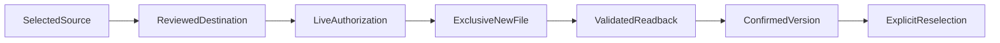

# Design amendment: separately selected profile versions

Status: requirements and design approved. All ten prerequisite tasks are approved; implementation is authorized and current validation remains outstanding. This amendment extends ProfileUpdate and leaves its existing replacement, fork and migration routes unchanged.

## Boundary Commitments

### This Spec Owns

- Exact preparation and confirmation of new reusable or application-profile versions, including current selection, generation, reviewed changes, provenance and destination authority.
- A bounded private-file creation policy and host lease contract that refinement may consume without importing profile algorithms into its checkpoint owner.
- Confirmed-file results and explicit source reselection. Career-evidence eligibility remains conditional on full validation.

### Out of Boundary

Checkpoint state, strategy arithmetic, document composition, WordCraft operations and release assembly retain their current owners. No existing file is privatized, replaced or deleted by the new route. There is no automatic migration, directory-wide version discovery or new service.

### Allowed Dependencies

Existing host file capabilities, profile selection and validation, pinned schema tooling and the existing trusted decision callback. The demonstrated Windows primitive uses Windows PowerShell 5.1 and platform-native .NET Framework file APIs. Other hosts require their own verified policy; Linux builds do not establish desktop persistence support.

### Revalidation Triggers

Changes to the reviewed envelope, creation policy, current-selection proof or confirmation results require profile, strategy, refinement, document-consumer and release regression checks. A changed package requires fresh installed acceptance.

## Architecture and compatibility

Add `prepareVersion(selected, request, destination, statementChoices = null)` and `persistVersion(decision)` to the existing `createProfileUpdates(host)` factory. Reuse its validation, exact-diff preparation, generation checks and private WeakMap capability registry. The existing methods never accept a new-version capability, and the new method rejects replacement/fork capabilities and serialized lookalikes.

Profile data remains 2.0 or scoped 2.1. Preserve the complete selected profile, including prior history and opaque migration origin; apply only the reviewed changes and the normal accepted-history entry. A 2.1 successor retains its exact immutable application scope and original-profile reference. Never promote an entire application profile. Retained 1.0 migration behavior is unchanged.

## Components and Interface Contracts

### ProfileUpdate new-version capability

The reviewed envelope contains the existing proposal/history IDs, generation, base hash, changes, source IDs, proposed profile and applicable statement choices, plus:

| Field | Meaning |
| --- | --- |
| `storage_mode` | Exactly `new_version`; no inferred fallback from a failed replacement |
| `source_selection` | Exact `{resolved_path, profile_sha256, schema_version}` consumed from current live selection |
| `resolved_path` | The distinct proposed destination, also bound by authorization |
| `creation_policy_id` | The currently verified, disclosed host policy selected for this operation |

Keep the fact-history authorization scopes already supported by the selected schema: initial intake or factual update for 2.0, and the applicable factual scope for 2.1. Storage mode is not a new history-scope enum. A migration cannot be smuggled into this route by changing the proposed schema version.

`host.userDecision` receives the whole exact envelope. An existing request can cover creation and subsequent selection if it explicitly names both effects and this destination. Otherwise those outcomes remain separate. Old approval for replacing the original cannot authorize a new path. Retained approval-shaped data never reconstructs a live capability.

Preparation does not switch selection. `persistVersion` confirms a file, not active canonical status. Its closed result reports `status`, `proposal_id`, `source_selection`, `destination: {resolved_path, sha256, schema_version} | null`, `active_selection: unchanged`, and findings. Only a later explicit `select` and complete validation can make that destination eligible. Reuse already-covered authority without another question.

### Private creation policy and lease

The initial supported policy is `windows-private-new-file-v1`: a local regular-file destination in an assessed private directory, current-user ownership, protected explicit DACL granting the current user and SYSTEM access, exclusive creation, exact reopened bytes, and stable native file/parent identities. Establish access controls at creation, not after exposing the contents. Reject redirected, multiply linked, encrypted or otherwise unsupported locations rather than broadening this policy silently.

The policy does not copy or attest original SACLs, enterprise classification metadata, encryption or other unassessed source properties. The original is opened read-only and never replaced or security-modified. Required additional obligations that the host cannot verify cause deferral; ordinary-user status and a policy label are insufficient. Do not change system audit policy or request elevation as the default workflow.

The trusted host exposes `acquireCreate({source, destination, policy_id, phase})`. Here source is null or an exact `{resolved_path, sha256}` artifact ref, destination is the authorized absolute new path, policy_id names the assessed policy, and phase is `create` or `inspect`. Only the owning live operation chooses phase. The profile owner always supplies its selected source; checkpoint consumers may use null only for an inspected initial baseline. This primitive has no career, strategy or document logic. It returns a lease or an explicit unavailable result, never an inferred success.

The lease provides:

- Exact resolved source and destination identities, policy ID, private location, stable identity, actual writer exclusion and exclusive-create guarantees.
- `readSource`, `readDestination`, one `createNew(bytes)` attempt, actual `verifyPolicy` inspection and `release`.
- Source handles excluding writes and deletion, parent handles excluding relocation, and a destination handle excluding readers/writers during creation. Recheck resolved containment, native identities, link/reparse attributes and assessed policy before and after the operation.

Create phase requires atomic create-new behavior. Inspect phase opens existing artifacts read-only and exposes no create/replace method; it can inspect a matching completed file, a partial file, an absent path or a still-busy operation without adopting or changing it. This lets an attempted capability reconcile after its original native handles have closed while retaining exact path, source and policy bindings.

For Windows, use native create-new semantics with security supplied at creation, restrictive sharing and flushed writes. The researched .NET Framework constructor accepts seven arguments; current ordinary-user probes verify these primitives. They do not certify a complete lease. The implementation must establish the whole interval and test races and unsupported-policy deferral. Cooperative locks, booleans or snapshot equality alone cannot supply those guarantees. This is a trusted-host contract, not a claim of isolation from malicious same-user or privileged host code.

## State, errors and recovery

Recheck the live selection, application scope where applicable, source bytes, destination absence and exact authority immediately before dispatch. Mark the capability attempted before invoking `createNew`. Once attempted, another call on that capability performs read-only reconciliation, never a second create.

Confirm only after exact reopened proposed bytes, full schema/semantic/task validation, unchanged source bytes and assessed properties, current selection context and verified creation policy. An occupied destination is a conflict even when its bytes match. A partial, absent-after-error or unverified destination remains unconfirmed. Retain it and the original; no automatic cleanup, retry, merge or overwrite follows.

A full host restart loses live capability authority. It may inspect and explicitly select a valid retained file as data, but cannot claim the interrupted operation confirmed or replay it from stored history. Report the uncertainty and obtain any genuinely new authority needed.

## File Structure Plan

| Files | Responsibility |
| --- | --- |
| `skills/targeted-cv/references/profile-updates.md` | New factory methods, closed envelope/results, shared creation policy/lease and Windows host guidance |
| `skills/targeted-cv/references/candidate-profile.md` | Explicit successor selection, generation and eligibility guidance |
| `tests/portable-candidate-profile/updates.test.cjs`, `persistence.test.cjs`, `persistence-acceptance.test.cjs`, `intake.test.cjs`, `integration.test.cjs` | Extend existing suites with new-mode positive, conflict, authority, isolation and native-host cases |
| `tests/portable-candidate-profile/foundation.cjs`, `full-acceptance.cjs`, `fixtures.json` | Current requirement mapping and complete validation; retain existing top-level suite inventory |
| `docs/your-facts.md` | Explain keeping the original, creating a version and selecting the next reusable source |

Refinement owns its application/checkpoint consumers. Release owns updated inventory, rights hashes and rebuilt installed evidence after the changed resources are validated.

## Requirements Traceability and Testing

| Requirement | Design and acceptance evidence |
| --- | --- |
| 7.3 | Selected source versus exact new destination; reject occupied or foreign targets |
| 8.1 | Exact live envelope/capability; source remains unchanged |
| 8.2 | Verified disclosed creation policy; no audit-copy claim; unsupported host negative |
| 8.3 | Race, redirect, link, identity, permission and occupied-destination controls |
| 8.4 | Reopened exact bytes, complete validation and native policy readback |
| 8.5 | Confirmed file versus explicit reselection, traceable history and request reuse |
| 8.6 | Interrupted create, read-only reconciliation and no replay after capability loss |
| 8.7 | Existing replacement deferral remains unchanged |

Use wholly fictional profiles. Verify ordinary-user native creation, source write/rename exclusion, private ACLs at creation, collision refusal, exact original/readback and unsupported guarantees. Test forged/cloned/stale decisions, selection-away-and-back, changed source, different candidate/application and mixed statement choices. Retain historical schema bytes and old-route regressions. A successful primitive probe or generic CI result never grants installed workflow acceptance.
