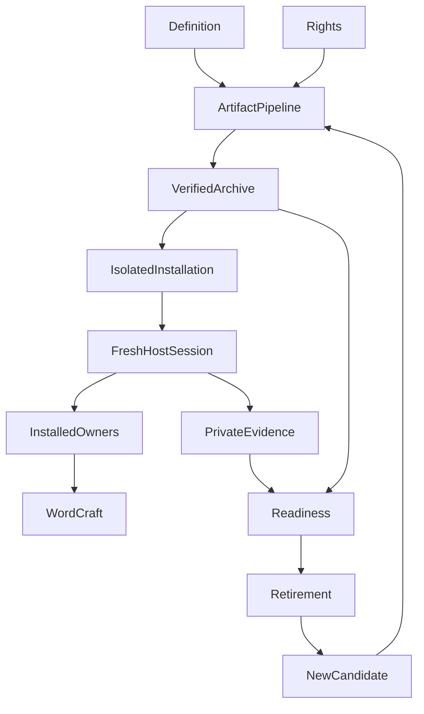
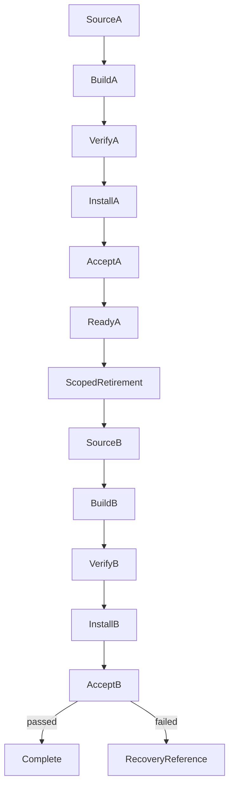

# Design Document

## Overview

M5 turns the validated checkout capability into an independently installable release candidate. Adopters receive a complete skill folder and instructions for their own private inputs. Maintainers receive artifact-bound installation evidence before the legacy application is retired.

Extend the existing release scripts and Dagger workflow. Keep application behavior in the approved M1 through M4 references and schemas. Packaging, installation checks and acceptance collectors are maintenance tools, not a replacement application or document service.

### Goals

- Produce inspectable artifacts containing the current runtime, adopter guidance, fictional sample and required licensing.
- Validate an actual extracted installation through fresh host sessions and WordCraft MCP, without checkout application helpers.
- Establish readiness for the exact artifact and retire only the named legacy files after replacement acceptance.

### Non-Goals

New scoring or writing algorithms, a custom MCP bridge, global host configuration changes, automatic publication and sibling catalog changes are excluded. Building on Linux does not establish a supported Linux desktop workflow.

## Boundary Commitments

### This Spec Owns

- Release identity, explicit asset mapping, rights records, package-format adapters and artifact verification.
- Adopter setup guidance and declared prerequisite/support status.
- Maintenance-only installed-acceptance records, readiness aggregation and the conditional tracked-file retirement plan.

### Out of Boundary

Profile validation and persistence, strategy eligibility and rubrics, composition, document operations and refinement state transitions remain upstream responsibilities. Release consumes their installed resources and evidence without granting new authority. Stored readiness, rights labels and hashes are records to verify, not substitutes for owner authorization or human judgment.

### Allowed Dependencies

Use `skills/targeted-cv/`, existing release scripts, pinned uvx schema validation, Node/pnpm maintenance tooling, Dagger, ZIP tools and the official WordCraft MCP. No runtime dependency on either checkout, copied test harness, external writing skill or model endpoint is introduced. Local sibling conventions inform package layouts; sibling code and catalogs are not imported or modified.

### Revalidation Triggers

- Changed package bytes, runtime content, templates, notices or format metadata invalidate the affected artifact's installation evidence.
- Changed host, platform, prerequisites or connection assumptions require fresh evidence for that support claim.
- Changed upstream contracts require their owner and direct consumer regressions before release acceptance.
- Retirement produces a new source revision and artifact identity; prior installed evidence cannot silently become evidence for the new artifact.

## Architecture

### Existing Architecture Analysis

The existing alpha tooling selects files, stages archives and verifies ZIP contents, but lists 25 of the current 31 runtime files. Its preparation and Dagger checks use M3 scope. M4's relocated tests copy a synthetic checkout and therefore remain regression evidence rather than installed host acceptance. Historical alpha notes and observations retain their original scope.

The runtime is a portable instruction/reference/schema tree. Preserve the 2.0 reusable profile and blank scaffold, 2.1 application profile, current 1.2 strategy/documents, 1.0 document/refinement sessions and retained historical validators. Package-only documentation, sample and licensing assets join the explicit release inventory without changing the validated core runtime.

### Architecture Pattern & Boundary Map

Definition and rights feed the package pipeline; verification and installed observations feed readiness. Retirement consumes accepted readiness. Upstream runtime owners do not import release code. Acceptance collectors may perform transport, filesystem and observation work, but must not supply prewritten application prose or run checkout owner implementations.

### Technology Stack

| Layer | Choice | Role |
| --- | --- | --- |
| Runtime | Existing Markdown and JSON contracts | Host reasoning and deterministic owner checks |
| Schema validation | check-jsonschema 0.38.2 through uvx | Required exact-instance validation in the installed workflow |
| Maintenance | Existing Node 22 and pnpm 10.18.3 baseline | Package and evidence checks, no background service |
| Build | Existing Dagger 0.21.8 workflow and declared container/tool versions | Local Debian/CI archive preparation and deterministic tests |
| Documents | Installed WordCraft desktop and official CLI MCP | Host-driven live authoring, inspection and saving |

Versions above are existing baselines to verify during implementation, not claims of latest versions. Record resolved image/tool identities with each build. No new package library is selected.

## File Structure Plan

| Path | Change and responsibility |
| --- | --- |
| `release/candidate.json`, `release/candidate.schema.json` | Tracked name/version-source, target/support and prerequisite declaration; schema also defines closed prepared-candidate and evidence records |
| `release/manifest.json` | Evolve to explicit source/destination/role/rights mappings for every payload asset |
| `release/rights.json` | New per-asset authorization and notice records |
| `release/check.cjs` | Extend definition, version, runtime-closure and rights validation |
| `release/prepare.cjs` | Stage a declared, source-bound snapshot and approved maintenance test closure |
| `release/package.cjs` | Reuse normalized ZIP production and generate declared format layouts and identity metadata |
| `release/verify.cjs` | New independent archive-entry, content, metadata, checksum and privacy verification |
| `release/readiness.cjs` | New read-only artifact-bound evidence aggregation |
| `release/retirement.json` | New exact tracked-file plan and prior-revision recovery reference |
| `release/README.md`, `release/notes.md`, `release/adopter-guide.md` | Maintenance commands, new candidate notes and the self-contained source copied to package README; preserve historical alpha scope |
| `.dagger/src/index.ts`, `.github/workflows/release.yml`, `package.json` | Integrate current deterministic gates and local build commands; keep publication separate |
| `LICENSE`, `THIRD_PARTY_NOTICES.md` | Add user-selected MIT declaration for project-owned content and verified included-asset notices |
| `VERSION` | Existing canonical release version, checked against package and generated metadata |
| `skills/targeted-cv/` | Reuse all 31 validated core assets unchanged; no new core helper or reference is planned |
| `README.md`, `docs/README.md`, `docs/your-facts.md`, `docs/application-workflow.md`, `docs/wordcraft-setup.md`, `docs/writing-skills.md` | Keep adopter guidance consistent with actual candidate scope and separate package versus checkout availability |
| `tests/portable-skill-release/fixtures/applicant-a.facts.json`, `applicant-b.facts.json` and associated offer/settings/turn JSON | Two complete fictional raw acceptance inputs; A is also copied as the explicitly selectable package example |
| `tests/portable-skill-release/manifest.json`, `scenarios.md` | Explicit maintenance closure, criterion map and observation classes |
| `tests/portable-skill-release/contracts.test.cjs`, `archive.test.cjs`, `installation.test.cjs`, `reproducibility.test.cjs`, `readiness.test.cjs`, `retirement.test.cjs` | Deterministic release contracts and adverse cases |
| `tests/portable-skill-release/installed-acceptance.md`, `observe-installed.cjs`, `acceptance-check.cjs`, `full-acceptance.cjs` | Fresh host acceptance procedure, bounded observation collection, read-only receipt validation and final orchestration |
| `docs/legacy-cli.md`, `.kiro/steering/product.md`, `.kiro/steering/tech.md`, `.kiro/steering/structure.md` | Update active legacy descriptions only after retirement; retained history points to a recovery revision |

CandidateDefinition owns the declaration/schema/rights inputs; ArtifactPipeline owns check/prepare/package/verify and Dagger integration; InstalledAcceptance owns adopter guidance, raw fixtures, collectors and installed checks; ReadinessRetirement owns readiness, retirement declarations and migration results. Other test files exercise those components without becoming runtime dependencies.

The retired files are listed separately under Migration Strategy. No recursive directory deletion is planned. No general host installer, dependency manager, native WordCraft wrapper or new runtime helper extraction is needed.

## Components and Interfaces

| Component | Intent | Requirements | Dependencies and contracts |
| --- | --- | --- | --- |
| CandidateDefinition | Declare exactly what is being built and supported | 1.1, 1.2, 1.4, 3.1, 3.2, 3.5, 6.1, 6.2, 6.3 | Existing runtime P0; owner license choice P0; closed input contract |
| ArtifactPipeline | Prepare and independently verify local artifacts | 1.3, 1.5, 2.1, 2.2, 2.3, 2.4, 2.5, 2.6, 2.7, 6.4, 6.6 | CandidateDefinition P0; archive tools P0; batch contract |
| InstalledAcceptance | Exercise and observe the actual installed skill | 1.6, 3.3, 3.4, 3.6, 4.1, 4.2, 4.3, 4.4, 4.5, 4.6, 4.7, 4.8, 5.1, 5.2, 5.3, 5.4, 5.5 | Verified artifact P0; host/installed owners/WordCraft P0; private observation contract |
| ReadinessRetirement | Aggregate evidence and gate bounded retirement | 6.5, 7.1, 7.2, 7.3, 7.4, 7.5, 7.6 | Artifact and installed evidence P0; retirement plan P0; read-only readiness/state contract |

### CandidateDefinition

`readCandidate(declaration, sourceSnapshot, inventory, rights) -> PreparedCandidate | InvalidDefinition` validates name, alpha version, selected full source revision, asset inventory, required notices, contract versions, prerequisites and target declarations. The tracked declaration points to `VERSION` and contains no current commit hash. Capture `SourceSnapshot` outside tracked inputs before preparation; writing a commit hash into the same commit would be circular. `VERSION`, `package.json` and generated format metadata must agree with the selected release version. The entrypoint name must match; do not add a redundant version field to the currently versionless entrypoint. Component contract versions remain distinct. Select a new alpha version relative to the existing alpha baseline during implementation and reject reuse for different payloads. Do not mutate published alpha notes to imply they included M4.

The primary operational acceptance target is a filesystem `targeted-cv/` installation in a Windows-local host connected to WordCraft. Record the actual host identity/version during acceptance. ZIP and `.skill` share the canonical runtime layout. A plugin-layout ZIP places `plugin.json`, `.codex-plugin/plugin.json`, `.claude-plugin/plugin.json` and `.gemini-plugin/plugin.json` beside `skills/targeted-cv/`, with RELEASE metadata at the plugin root. These generated metadata views use the same name/version and resource payload. Codex uses `skills: "./skills/"`; the locally observed Gemini view uses `skills: ["./skills/"]`; preserve the locally observed Claude layout without assuming identical keys. No marketplace file is generated. Each wrapper records `layout_verified`, `host_load_verified` and `workflow_verified` independently; local ecosystem conformance is not an official host compatibility claim. A wrapper cannot advertise operational support without its own host/platform evidence. No catalog registration or global host setup occurs.

The applicant host needs private file access, hashing, execution of the embedded JavaScript algorithms with trusted filesystem adapters, the pinned uvx validator and a desktop-connected MCP session. A host may supply JavaScript execution itself; if the chosen host uses external Node/pnpm, record that as its runtime prerequisite rather than conceal it as maintenance-only. Dagger, archive tools and the checkout test harness are maintenance dependencies. Missing exact validation remains unassessed and blocks dependent claims.

The user selected MIT for project-owned code and skill content. Create the project license during implementation and include its text in every artifact. `rights.json` records each asset's origin, license/authorization reference, notices and reviewed status, bound to its source hash. The license choice does not prove ownership of third-party content. Do not bundle optional writing skills, publisher PDFs or publisher templates. Their links and fallback instructions remain references. Unresolved rights allow local investigation but prevent a verified distributable/readiness result.

### ArtifactPipeline

The manifest distinguishes the unchanged 31-file core closure from package extras: `release/adopter-guide.md` maps to package `README.md`, fictional applicant A maps to `examples/sample-facts.json`, and project license/notices map to package-root files. The full package inventory includes every category. This keeps existing M4 runtime evidence current while M5 independently binds the additional payload. A core edit, if later found necessary, triggers upstream revalidation and fresh affected actual evidence; it cannot be hidden as packaging.

Preparation emits an external source-snapshot descriptor containing the selected revision, source epoch and exact generic build-input inventory. Both `release/README.md` local commands and `.github/workflows/release.yml` consume it and pass explicit source-revision/source-epoch arguments into Dagger. Dagger checks those values against the prepared descriptor; it does not reconstruct them from synthetic Git. `prepare.cjs` must explicitly include the new verifier, candidate declaration/schema, rights records, mapped extras and M5 maintenance closure, not only extend the archive payload list.

Keep public CLI entrypoints and expose small callable functions for tests; remove side effects on module import. Maintenance functions are `prepareCandidate(definition, destination)`, `buildArtifacts(prepared, output)`, and `verifyArtifact(archive, expected, privacyContext)`. Arguments are explicit paths/records; shell tools receive argument arrays. These functions never discover candidate inputs or create/read application documents.

Preconditions are a selected source revision, exact payload file hashes matching that revision, verified prerequisites and a fresh output destination. A development snapshot may be built only as explicitly non-release-ready. Capture revision and source epoch before Dagger staging; synthetic `git init` cannot supply source provenance. Extend Dagger `dist(source: Directory, sourceRevision: string, sourceEpoch: string)` with explicit provenance inputs rather than discovering them from staged Git. The container receives only declared generic build/test assets, never private candidate files, private receipts, author configuration or credentials. Existing tag-triggered publication must not run for candidate preparation.

Archive layout is format-specific:

| Format family | Core skill prefix | Format-root additions |
| --- | --- | --- |
| Portable ZIP and identical `.skill` alias | `targeted-cv/` | README, sample, LICENSE, notices and RELEASE metadata inside that skill root |
| Ecosystem plugin ZIP | `skills/targeted-cv/` | Generic and three host metadata files plus root RELEASE, LICENSE and notices; README/sample/license/notices also remain inside the canonical skill payload |

Every payload entry is mapped by its final destination, including duplicated license/notice bytes at the plugin root. The portable inner metadata declares the portable format family so the byte-identical ZIP and `.skill` aliases do not contradict it. Outer artifact records distinguish the filenames/formats. `RELEASE.json` records name, version, source revision, capability scope, format, contract/prerequisite declarations and payload hashes. Its own bytes are bound by the outer artifact record, avoiding a self-hash cycle. Outer records contain archive SHA-256, size, identity-metadata hash and payload inventory digest. Include templates, samples, setup guidance and license files in integrity checks; do not inherit M4's template exclusion.

Independently list and inspect the actual archive before extraction. Reject absolute/traversal paths, duplicate or platform-colliding names, symlinks/redirects, unsupported entry types, extra/missing entries, mismatched content and unexpected executable metadata. Extract only into a fresh explicitly selected directory, then recheck resolved containment and exact installed contents. Check binaries, text and metadata under the project privacy policy; scan identifiers only from explicitly supplied private context on the host and retain human inspection. Private scanning inputs never enter the Dagger context or artifact.

Require both fresh staging and fresh archive-output directories. Reject an existing destination archive before invoking ZIP, which would otherwise update it in place. Multiple formats and repeat builds use distinct new destinations with no automatic overwrite or retry.

Build twice in fresh directories with identical selected inputs and recorded toolchain identities. Compare payload content and archive bytes separately. Normalization reuses sorted entries, stable epoch and regular-file modes. A mismatch is reported with the affected layer; content-only reproducibility does not imply identical archive hashes. Installed evidence always binds the specific accepted archive, even if another archive has equivalent content.

### InstalledAcceptance

Installation is a documented host operation, not a permanent installer service. Select the installation directory explicitly. For an initial install require destination absence; stage beside the destination, verify every installed asset and publish only the managed skill folder. For updates require an exact prior managed inventory, reject unmanaged additions or changed candidate-like files, retain a recovery copy, and replace only that folder. On failure retain both user work and the last confirmed managed installation; do not silently merge, delete or overwrite. Never store facts, outputs or application checkpoints inside the replaceable skill folder.

`observeInstalled(selection) -> observation` collects hashes/identities and transport observations only. `verifyInstalledEvidence(artifact, install, evidence, review) -> CheckResult` is read-only. The collector and verifier are maintenance tools outside the package. Profile persistence adapters must meet the installed owner's stable-path, exclusive-writer, security-preserving stage/backup/replace/read-back and exact-envelope authorization contracts; fictional data does not waive those requirements. They may supply declared filesystem/transport adapters, but owner algorithms must be loaded from the installed references. The application flow must not import checkout fixtures, owner modules or expected prose.

Start a fresh host session with only the installed entrypoint, explicit raw fictional facts/offer and a private external working directory. Record installed resources read, prerequisite observations and the exact installed asset inventory before and after. A source checkout or sibling resource access fails standalone acceptance. This is trace-based validation, not a claim of an operating-system sandbox. Load references progressively as the task needs them.

Applicant A completes the bilingual four-member application, including the existing owner intake/strategy, focused question, qualitative answer, skipped distinction, explicit local/reusable fact choices, confirmed persistence and targeted live refinement. Applicant B completes a separate CV/letter application from independently selected facts and state. Test selection of an application-scoped A source for B and reject it. Both applicants' identity and qualification content must come from their structured input, never the environment or package sample by default.

The fresh host receives raw inputs and scripted applicant turns, not a prewritten CV, expected wording, prior verdicts or M4 driver output. A later competent review evaluates actual claims and pages. Preserve every selected document separately, actual MCP intents/results, exact read-back, save/reopen, all page renders, reading order, automatic page fields and applicable Germany letter geometry. Show and identify document switches through the existing session behavior and respect subsequent user focus changes. No computer-use tools or other document service are introduced.

Capture a real pending member before resolving it and an explicit stopped boundary with no later questions or mutations. Include one controlled real interrupted edit and inspect/reconcile without replay under the installed session/refinement owners; deterministic absent/ambiguous and missing-capability controls stay separate. A missing mandatory live result is not replaced by older checkout observations. Existing M4 evidence remains useful regression history only.

Package-local guidance covers the intended application flow, safe update, structured data boundaries, WordCraft connection, exact validation prerequisites and optional COBESY/Humanizer installation or fallback. Preserve the existing explicit-choice behavior and existing installations. The complete fictional 2.0 example is a copyable input requiring selection, while null/unknown fields remain honest. Validate its structure and semantics independently of the blank scaffold.

### ReadinessRetirement

`evaluateReadiness(candidate, verifiedArtifacts, installedEvidence, checks, rightsReview) -> ReadinessReport` returns `ready`, `blocked` or `not_assessed`, with separate gate results and reasons. It performs no installation, publication, profile update or document mutation. Missing or stale evidence fails closed. Different versions or matching runtime hashes alone cannot transplant installed acceptance to another archive. Mandatory definition, rights, privacy/integrity, primary-target installed acceptance and affected regression gates must pass. Secondary formats without host-workflow claims may remain operationally unassessed, clearly labeled. Payload reproducibility must pass; archive-byte reproducibility is reported separately, with unexplained differences blocking verification and explicitly explained variability limiting the reproducibility claim. No variant can inherit another archive's installed evidence solely from equal content.

The tracked retirement declaration holds paths/policy, not build-generated approval or artifact references. A separate private attempt joins that declaration to current observations. `checkRetirement(plan, acceptedCandidate, currentSource) -> RetirementDecision` requires accepted artifact identity, installed support evidence, regressions, rights/privacy/integrity results and the approved exact tracked-path inventory. Task approval covering the unchanged plan is reused; stored approval-shaped data cannot enlarge its scope. Keep the prior revision and dedicated retirement diff as recovery references. No remote release, tag, registry or sibling catalog is changed by readiness or retirement.

## Data Models

Use closed, versioned JSON maintenance records; unknown fields are rejected at trust boundaries. They are not new candidate or application contracts. `candidate.schema.json` defines candidate, artifact, installed-evidence, readiness and retirement record variants with a discriminator. Public declarations contain no candidate instance or machine paths. Private observations may contain explicitly selected fictional paths and application data under ignored outputs or an external workspace.

| Record | Required fields and invariants |
| --- | --- |
| Candidate declaration | Tracked name, version-source, scope, contract versions, target/prerequisite policy and inventory/rights references; no self-referential source revision |
| Prepared candidate | Generated schema version, name/version, selected full source revision/epoch, complete asset hashes and verified build inputs; immutable selected snapshot |
| Asset | Source-relative path, package-relative destination, role, size/hash and rights reference; exact source snapshot, regular file, no redirected path |
| Artifact | Format, filename, size, SHA-256, RELEASE metadata hash, payload digest and build-input identity; no self-referential digest |
| Installed evidence | Artifact ref, selected installed root/hash inventory, host/platform and prerequisite observations, source-read trace, applicant-isolated selections, owner receipts, actual operations/outcomes, saved files/renders and competent reviews |
| Check result | `passed`, `failed` or `not_assessed`; method, exact input/output refs, scope and limits; observation class `actual`, `control` or `host_judgment` |
| Readiness report | Exact candidate/artifacts, gate results, support matrix, unresolved limits and immutable evidence index/digest; no mutation authority |
| Retirement declaration and private attempt | Tracked exact remove/update lists and recovery policy; separate private attempt binds the accepted A artifact/revision, current approved scope, execution outcome and new B candidate |

Callable maintenance functions return a discriminated result: `passed` with a validated value/check list, or `failed`/`not_assessed` with typed issues. An issue has category (`definition`, `integrity`, `rights`, `prerequisite`, `evidence`, `destination` or `retirement`), affected scope and next action. Readiness separately uses `ready`/`blocked`/`not_assessed` and cannot authorize mutations.

SHA-256 strings use a 64-hex pattern; versions and paths have explicit validation. JSDoc types and boundary validation apply to the existing JavaScript maintenance modules. Dagger TypeScript uses precise types and no `any`. Host/operator trust is explicit: a self-reported ready field or a recomputed digest of changed evidence cannot authenticate the original observations. Select the evidence index and its expected digest independently, then verify every referenced file and review against the selected artifact and installation.

## System Flows

The final branch is conditional: only passing B acceptance permits completion. Failure retains a retirement-incomplete report and the recovery reference. Build and evidence records identify A and B separately. This avoids demanding an already-retired source before permission to retire it, or relabeling A evidence as B evidence.

## Requirements Traceability

| Requirement | Design coverage |
| --- | --- |
| 1.1 | Candidate identity, source snapshot and inner/outer artifact records |
| 1.2 | Primary filesystem target and separate format/host support statuses |
| 1.3 | Explicit runtime closure and installed reference resolution |
| 1.4 | Current contracts and retained compatibility resources in manifest |
| 1.5 | Candidate and archive verification rejection |
| 1.6 | Managed-folder staging, exact update inventory and external user data |
| 2.1 | Explicit source/destination allowlist for every format |
| 2.2 | Forbidden candidate/configuration assets and context exclusion |
| 2.3 | Independent actual-entry/content/metadata inspection |
| 2.4 | Path/type/collision/content validation and safe failure report |
| 2.5 | Artifact SHA-256, source revision and payload digest |
| 2.6 | Two fresh preparations and separate content/byte results |
| 2.7 | Failed gates withhold readiness and preserve private files |
| 3.1 | Applicant versus maintenance and optional prerequisite declarations |
| 3.2 | Host/platform matrix, versions and connection assumptions |
| 3.3 | Fresh desktop MCP discovery and read-only identity check |
| 3.4 | Missing prerequisite/capability response under existing owners |
| 3.5 | Installed instruction runtime, no project model endpoint or service |
| 3.6 | Package-local optional-skill choice and fallback |
| 4.1 | Actual artifact extraction, fresh host and installed-only owner loading |
| 4.2 | Two isolated fictional applicant workflows |
| 4.3 | A bilingual four-member set and B separate CV/letter |
| 4.4 | Question, skip, qualitative answer and diagnostic limits |
| 4.5 | Installed fact choices, confirmed persistence and manual preservation |
| 4.6 | Actual MCP receipts, every page and competent review |
| 4.7 | Pending, real interrupted edit, recovery and stopped trace |
| 4.8 | Exact artifact/installation evidence gate and observation classes |
| 5.1 | Package-local README and progressive setup/application routing |
| 5.2 | External private data and application/reusable distinction |
| 5.3 | Complete validated 2.0 fictional example with explicit selection |
| 5.4 | PowerShell/Bash and applicant/maintenance command labels |
| 5.5 | Candidate, published alpha and support-status separation |
| 6.1 | Per-asset rights and required license/notices |
| 6.2 | MIT owner choice with unresolved third-party rights blocking readiness |
| 6.3 | Setup/source links excluded from bundled third-party content |
| 6.4 | Existing Dagger/local/CI entrypoints and recorded check scope |
| 6.5 | Read-only readiness report with all gate outcomes |
| 6.6 | Local preparation isolated from tag/publication/catalog paths |
| 7.1 | Accepted A artifact required before scoped retirement |
| 7.2 | Failed prerequisites retain legacy and report blockers |
| 7.3 | Explicit tracked remove/update lists and private-folder exclusions |
| 7.4 | Preserve upstream deterministic behavior; no retained legacy runtime imports |
| 7.5 | Active documentation/dependency/CI migration after removal |
| 7.6 | Fresh artifact B validation and prior-revision recovery reference |

## Error Handling

| Failure | Required response |
| --- | --- |
| Missing/dirty source, version mismatch or incomplete runtime closure | Reject release-ready preparation; report selected-source mismatch |
| Unresolved rights or omitted notice | Block distributable verification/readiness; retain owner decision context |
| Archive path, entry, metadata or hash mismatch | Reject before installation; retain original archive and sanitized discrepancy |
| Destination collision, unmanaged file or partial update | Preserve user work and prior managed copy; inspect before another installation attempt |
| Missing host execution, validator, MCP capability or foreground action | Report affected action and pending state through existing owners; no fabricated success or repeated focus requests |
| Missing/stale installed receipt, unreviewed claims/pages or imported ready flag | Block support/readiness claim, identify missing current evidence |
| Failed post-retirement B validation | Report retirement incomplete; retain A/recovery refs and prepare only the scoped recovery change, never reset unrelated work |

There are no automatic mutation retries. Existing profile/document owners reconcile uncertain application writes. Release checks log paths and identifiers only when those belong to wholly fictional private evidence; shareable reports describe result classes without identifying paths or real candidate excerpts.

## Testing Strategy

- **Definitions and rights:** version/source mismatches, omitted current or historical dependency, template/sample exclusion, unresolved rights, missing MIT text/notices and invalid support status (1.1 through 1.5, 2.1, 3.1, 3.2, 6.1 through 6.3).
- **Archive and installation:** independently corrupt, omit or add entries; path traversal, redirects, case collisions, executable metadata and altered inner/outer hashes; managed update collision, existing private files and partial staging; two fresh builds with content and byte comparison (1.6, 2.2 through 2.7).
- **Installed positive flow:** fresh sessions load only installed owner references; A produces four bilingual documents and B a separate application; raw scripted turns exercise questions, skip, local/reusable persistence, manual prose/format preservation, a pending member and actual interruption recovery; reviewers inspect every final page and source meaning (3.3, 4.1 through 4.7, 5.1 through 5.3).
- **Installed negative flow:** absent uvx/JavaScript/MCP, wrong application source, stale installation, old receipt, omitted template, missing review and unsupported host claim; stop has no later questions or mutations; optional-skill decline retains fallback (3.4 through 3.6, 4.8, 5.4, 5.5).
- **Readiness and retirement:** missing mandatory gate, simulated-live substitution, changed artifact, injected approval, A/B evidence substitution, scope expansion, ignored-file preservation and obsolete active setup links (6.4 through 6.6, 7.1 through 7.6).

Canonical maintenance entrypoints are the existing pnpm release scripts, extended with artifact verification, installed-evidence checking and readiness subcommands. Dagger/CI execute deterministic and archive gates with generic fixtures; they report desktop-installed acceptance as unassessed unless separately supplied current artifact-bound host evidence is verified. The connected Windows host runs installed acceptance and private privacy/meaning review outside the container. CI success alone never grants full readiness. The complete final runner checks every declared suite, nonzero test counts, zero skipped mandatory checks and all 44 criteria; regressions retain version-specific validators. No fabricated live receipts enter unattended CI.

## Migration Strategy

Keep legacy until accepted A readiness. The exact initial deletion candidates are `main.py`, `ats_agent.py`, `cv_parser.py`, `ats_industry_standards.py`, `german_cv_knowledge.py`, `example.py`, `requirements.txt` and `.env.example`. Confirm they remain tracked legacy-only files during implementation; a changed ownership/import finding returns to the owning boundary. Retain `docs/legacy-cli.md` as a short clearly historical recovery pointer or remove it with its active links. Remove active legacy usage from `docs/README.md` and update steering/dependency/CI descriptions.

Current deterministic checks are implemented independently by approved upstream owners. Preserve their tests and behavior; do not retain heuristic Python page counts or substring scoring as replacement runtime. uv/uvx may internally run Python without constituting a maintained application.

Create dedicated source revision B for the approved tracked retirement changes and build its own artifact because embedded source identity changes. Run applicable installed acceptance and regressions for B before declaring retirement complete. If B fails, preserve the report and recovery reference and restore only the dedicated approved legacy paths or revert that dedicated change without rewriting history or discarding unrelated edits. Never delete ignored `private/`, `examples/`, `outputs/`, user `.env`, documents or backups.
