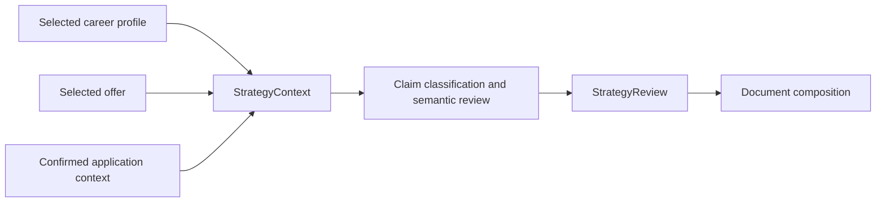

# Application evidence design amendment

Status: design gate PASS after one bounded repair; human-approved on 27 October 2026. Runtime changes are not implemented. This amendment extends the existing strategy design; unaffected contracts and all 48 existing requirements remain in force.

## Overview

A complete application contains career claims, statements about an offer and details specific to that application. Strategy validates each against its proper source. It does not copy recipient addresses or application intent into the reusable career profile.

The correction extends the existing host-session protocol and closed JSON contract. It introduces no service, external dependency, model call or document engine. Document creation remains with WordCraft MCP.

## Boundary Commitments

- Strategy owns context evidence, source binding, claim classification, semantic support and invalidation.
- Profile retains ownership of candidate facts, their evidence semantics and confirmed updates. Its schema and persistence protocol remain unchanged.
- Documents consumes the reviewed claims and maps its confirmed letter metadata to the same context records. It does not implement a second support evaluator.

### Out of Boundary

Conversation scheduling, WordCraft operations, letter geometry, profile migration and packaging remain with their current owners. This amendment does not extend the sources allowed to prove a candidate qualification or achievement.

### Allowed Dependencies

Use the current profile validator, host-selected offer, explicit application input and existing schema/reference-block test harness. Context selection and confirmation are host observations, not assertions trusted from an incoming draft.

### Revalidation Triggers

Revalidate strategy contract, editorial and review consumers together. Revalidate document composition, manifest integrity, check-only refresh and bilingual acceptance after the strategy changes. Later refinement and release specs must consume the amended contract. Existing document-session operations and profile persistence require regression checks, not redesign.

## Architecture

Keep the four existing responsibilities: StrategyContext binds inputs; EvidencePlanner retains career-only qualification mappings; PositioningEditor classifies and reviews claims; StrategyReview checks support and comparisons.

## Data Models and Interfaces

### Version and compatibility

New handoffs use strategy schema version `1.1`. Keep the existing `1.0` schema as `application-strategy-v1.schema.json` for historical validation. The current schema accepts only `1.1`; older consumers reject it rather than silently drop context evidence. This is an explicit contract upgrade despite the additive field structure.

Do not upgrade a saved `1.0` handoff by inserting defaults or retaining its old ready status. Select and validate current inputs, rebuild the handoff and review all selected claims under `1.1`. Historical artifacts remain unchanged. A new run cannot compare across versions until both sides have been freshly reviewed with the same contract, source binding and rubric. No automatic migration of career facts is needed.

Document manifests also move to `1.1`. Archive the old schema as `application-documents-v1.schema.json`, changing only its relative Binding reference to the archived strategy 1.0 schema so historical validation keeps its original meaning. The current manifest references current strategy 1.1. Both consumers explicitly reject unknown versions; neither dispatches solely by whichever schema file happens to occupy the current path.

### ApplicationContext

Add required top-level `application_context: ApplicationContext | null`. Null supports CV-only and role-only cases that do not need contextual claims. A non-null context has the following closed shape:

| Field | Definition |
| --- | --- |
| `application_id` | Host-assigned opaque identifier for this selected application |
| `target_sha256` | Exact current offer or role-target hash |
| `records` | Unique-ID array of the records below |

Each record contains `id`, `kind`, `value`, `provenance`, and `confirmation`. Kinds are `recipient_name`, `recipient_organization`, `recipient_address`, `application_date`, `salutation`, `application_intent`, and `enclosure`. Value is a nonempty string, except recipient_address uses a nonempty array of nonempty strings and enclosure uses an array of nonempty strings which may be empty. A confirmed empty enclosure array means no attachments; the manifest retains one reference to that record. Dates use ISO calendar dates internally, with localized rendering reviewed separately. Each assertion occupies one record; unrelated facts cannot be hidden in an address or intent record.

Provenance has the closed shape `{kind, reference, observed_at, offer_span}`. Kind is `user_input | selected_offer | host_proposal`; reference is a nonempty private source/interaction identifier and observed_at is an ISO timestamp. For selected_offer, offer_span is `{start,end,excerpt}` checked against the selected offer; for other kinds it is null. A host proposal can be retained pending; its existence is not confirmation.

Confirmation is null or `{application_id, record_sha256, interaction_ref, confirmed_at}`. Compute record_sha256 with the existing `fingerprint({id,kind,value,provenance}, sha256)` helper and its recursively key-sorted `stableSerialize`; do not introduce a second serialization convention. The context file hash covers its exact saved UTF-8 bytes, including confirmations. No self-referential context hash is stored inside those bytes.

Add required binding members `application_id: string | null` and `application_context_sha256: string | null`. Both are null when context is null. Context is saved separately from career facts in the selected private application directory.

The host independently supplies selected context bytes and current confirmation observations to `bindStrategy` and integrity checks. The checker verifies the parsed handoff context equals those selected bytes, hashes match, application and target IDs match, and each used confirmation matches a host-observed interaction and record hash. Copying the same fields into an incoming draft cannot establish this trust. On resume, independently reselect and reconfirm context before using it; no directory scan or inferred confirmation from old ready status.

Extend `createStrategyContext.current()` to inspect independently current target and context selections as well as the profile. Recheck after asynchronous validation and before assembly/consumption. A frozen copy of the original input cannot establish that selection is still current. Missing context does not prevent a canonical-only CV from proceeding.

### Claim evidence

Preserve `EvidenceRef` unchanged and career-only in criterion mappings, terminology and existing claim `evidence`. Add two required claim members:

- `subject: candidate | offer | application | mixed`
- `context_evidence: ContextEvidenceRef[]`

`ContextEvidenceRef` is a closed discriminated union:

- Offer: `{kind: 'offer', target_sha256, start, end, excerpt}`. Offsets are zero-based Unicode code points `[start,end)` into the exact selected offer text. Reject empty/out-of-bounds spans, mismatched excerpts/hashes and role-only targets.
- Application: `{kind: 'application', application_id, context_sha256, record_id, pointer}`. Pointer is `/value` or `/value/<index>` for an existing array element, relative to the referenced record. Reject unknown records, invalid pointers and stale bindings. A well-formed reference to a record whose confirmation is null is unresolved support, not a global integrity failure; a present forged or stale confirmation is an integrity failure.

Do not repurpose `target_references`: those continue to express relevance to criteria or inferred needs, not evidence.

| Claim subject | Required evidence |
| --- | --- |
| Candidate | At least one valid canonical EvidenceRef; contextual references cannot replace it |
| Offer | At least one valid offer reference |
| Application | At least one valid confirmed application reference |
| Mixed | Canonical evidence plus at least one valid contextual reference |

This table defines eligibility for supported status, not schema array minimums. Claims with empty evidence arrays remain representable as unsupported or unresolved inventory entries. They cannot become supported through a subject label alone.

Split independently verifiable propositions before classification. A phrase joining career experience to an advertised need retains both sources; host review must verify the relationship as well as each source. Offer-plus-application wording without a candidate assertion is split into distinct claims. Classifications are host-reviewed semantic judgments, not labels that an imported handoff can grant itself. Employer culture, future outcomes and candidate authority cannot be inferred from a matching source string.

### Support and readiness

Replace every canonical-evidence-length shortcut with one shared strategy-owned eligibility rule, used consistently by assembly, editorial review, diagnostics and integrity recomputation. It checks required source classes, current bindings and reference resolution. It never establishes meaning on its own.

Per-language semantic review still determines `supported`, `unsupported` or `unresolved`. Valid contextual references plus reviewed meaning may support an offer/application claim with an empty canonical evidence array. Missing confirmation yields unresolved support and a focused input request, not a fabricated qualification or a zero suitability score. Invalid/forged references are blocking integrity failures. A failing selected realization is withheld from that language's document draft; supported independent work remains usable.

Every factual proposition stays in the claim inventory and support denominator. Context claims do not count as candidate qualification evidence or increase offer-coverage mappings. Rubric formulas and weights remain unchanged.

### Changes and comparisons

Changing target invalidates its context binding and all dependent reasoning. Changing context bytes or confirmation invalidates the old handoff and all affected claim reviews and document checks. Rebuild from current inputs; unchanged career evidence remains available for fresh review.

Whole-draft claim-support and editorial comparisons require matching application ID and context hash, in addition to existing constraints. A changed context yields `not_comparable` with side-by-side results and an explanation. Offer-coverage comparison can remain eligible only when its existing career/target/criterion/rubric bindings match, because context evidence cannot enter its mappings. Document comparisons keep their own artifact and method bindings. Context changes cannot use the document check-only rebind path.

Comparison validates prior snapshots against independently retained host-established source observations, not `binding: previous.binding` alone. Include claim subject and canonical/context reference identities in proposition signatures. Missing prior observations or changed evidence classification/reference population prevents a numeric claim-support delta even if prose and claim IDs match.

### Document metadata linkage

In manifest 1.1, each existing confirmed letter-input field gains `context_refs`, an ordered array of application references. Recipient may combine recipient-name, organization and address records; date, salutation and enclosures map to their respective kinds. The manifest's value must equal the referenced values, with only declared language formatting: recipient lines joined by newlines, ISO dates localized for the document language, and enclosure arrays preserving order. Missing refs or confirmation remain in `missing_required` and keep only the affected letter pending. A caller's `confirmed: true` or arbitrary provenance string is never sufficient. Localized intent and other prose remain reviewed strategy claims, not new metadata rules.

## File Structure Plan

| Component | Files and change |
| --- | --- |
| StrategyContext | `skills/targeted-cv/schemas/application-strategy.schema.json`: 1.1 definitions; new `application-strategy-v1.schema.json`: unchanged historical 1.0 schema |
| StrategyContext | `skills/targeted-cv/references/strategy-contract.md`: source resolution, shared eligibility, closed validation and compatibility |
| StrategyContext | `skills/targeted-cv/references/application-strategy.md`: independent context selection/confirmation, assembly and invalidation |
| EvidencePlanner | `skills/targeted-cv/references/strategy-evidence.md`: keep candidate mappings canonical-only; route context questions separately |
| PositioningEditor | `skills/targeted-cv/references/strategy-editorial.md`: subject classification, mixed propositions and bilingual semantic review |
| StrategyReview | `skills/targeted-cv/references/strategy-review.md`: eligible contextual support, consistent recomputation and comparison scope |
| Verification | `tests/targeted-application-strategy/application-context.test.cjs`: new source-binding and rejection cases; existing fixtures, contract, editorial, integration and relocation suites updated for 1.1 |
| Document consumer integration | `skills/targeted-cv/references/application-documents.md`: consume 1.1, link letter metadata to current context, prohibit context-change check-only refresh |
| Document consumer integration | `skills/targeted-cv/schemas/application-documents.schema.json` and new `application-documents-v1.schema.json`: versioned metadata refs and stable historical binding |

No standalone context service or generic source registry is introduced. Reuse existing test loaders and profile/session adapters. Consumer updates are explicit integration work after the strategy contract, not document-side workarounds.

## Testing Strategy

1. Accept a confirmed recipient/date/intent claim and an exact offer claim with no canonical evidence. Reject blank, forged, stale, wrong-target and wrong-application context, invalid spans and references into confirmation fields. Test the actual shipped blocks and real schema, without stubbing validation (1.3, 3.2, 7.1, 7.4, 8.3).
2. Reject contextual evidence as proof of candidate qualifications, including an imported candidate assertion mislabeled as application intent. Verify semantic review catches misclassification and mixed-source overstatement in both languages. Keep qualification mappings canonical-only (3.1, 3.2, 3.4, 4.4, 6.2).
3. Confirm assembly, editorial review, diagnostics and integrity recomputation agree on contextual-only claims. Check all assertions remain in the support denominator; failed translation blocks only affected selected output, and missing context permits independent supported work (1.5, 4.4, 6.1, 6.3, 6.4, 6.8).
4. Change context, target and confirmation independently. Reject stale reuse and check-only document refresh; show explicit non-comparable editorial/support results. Preserve eligible career-only coverage comparisons and unchanged score formulas (7.3, 7.4).
5. Validate archived 1.0 artifacts historically, reject them in the current consumer, and rebuild from selected sources without inheriting prior ready status. Run canonical regression and relocated tests without private data, model credentials or a sibling repository (1.1, 1.8, 8.4, 8.5).
6. Complete the existing M3 English/German CV and letter acceptance, including confirmed context, exact WordCraft read-back, save/reopen, all-page review and preservation of manual edits. Strategy tests alone cannot mark M3 complete.

## Implementation sequence for task planning

After design approval, append bounded tasks to the existing strategy plan: (1) versioned contract and eligibility, (2) host/editorial/review integration, (3) document consumer integration, (4) regression/relocation and strategy validation. Then resume existing M3 tasks 7.1 and 7.2. Keep completed task history and prior validation evidence; the correction requires fresh acceptance.

## Requirements Traceability

The existing design's 48-criterion mapping remains applicable. This amendment specifically implements separate target/context input (1.3), bounded missing-input handling (1.5), canonical update isolation (1.6), reference meaning and authority (3.1, 3.2, 3.4), bilingual claims (4.4), distinct diagnostic evidence (6.1, 6.2, 6.3, 6.4, 6.8), current handoff and comparison (7.1, 7.3, 7.4), and source/privacy boundaries (8.3, 8.4, 8.5).
