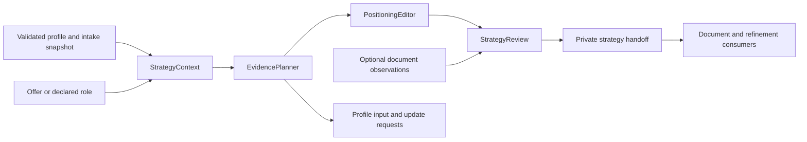
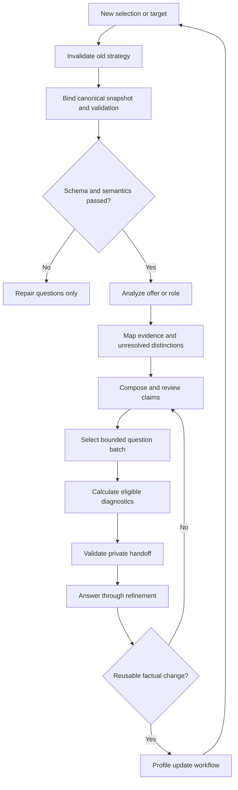

# Design: targeted application strategy

The approved [application-context amendment](application-context-design.md) defines the 1.1 correction to this design. Its explicit source, binding, compatibility and consumer rules supersede the corresponding 1.0 rules below. The original implementation and validation remain historical evidence; the amendment is implemented and validated in contract 1.1.

## Overview

Application Strategy turns an explicitly selected private profile and an offer or declared role into a contribution argument, supported claims, useful questions and qualified diagnostics. The host agent interprets evidence and writes. Deterministic checks enforce input bindings, reference integrity, question limits and score arithmetic.

This is a skill protocol implemented in portable reference assets, not an application or model-service client. It supplies private results to document writing and refinement. The final skill entrypoint belongs to release integration.

### Goals

- Preserve relevant evidence while making responsibility, scope and contribution understandable.
- Separate explicit requirements, inferred needs, evidence states and editorial judgments.
- Make questions and score changes useful without claiming to predict hiring.

### Non-Goals

Profile persistence/migration, document extraction/rendering/edits, conversation scheduling, submissions, psychometric assessment and package installation. Strategy may offer optional writing-skill installation through the host; it does not implement an installer.

## Boundary Commitments

### This Spec Owns

- Offer analysis, evidence mappings, localized claim proposals and positioning.
- Question candidates, suppression rules and next-batch selection.
- Versioned diagnostics, findings, private handoff schema and revision comparison.
- Self-contained editorial and source guidance.

### Out of Boundary

Profile owns selection, validation, evidence semantics and authorized updates. Documents owns actual checks and edits. Refinement owns presenting questions, collecting answers and coordinating changes. Release owns the entrypoint and packaging. Strategy consumes their contracts without redefining them or claiming they are delivered.

### Allowed Dependencies

Validated profile references, host reasoning/file tools, explicitly supplied application inputs, optional discovered COBESY/Humanizer skills and optional public occupational sources. Tests use the existing pinned schema validator through uvx. No legacy scorer execution, model SDK, additional model credential, private-data search or sibling Skills checkout dependency.

Dependency direction: profile contract -> strategy contract -> interpretation/editorial protocol -> deterministic review/handoff -> document/refinement consumers. Optional document observations enter review as data; no WordCraft operation is required for text-only strategy.

### Revalidation Triggers

Profile selection/evidence/validation changes require integration tests. Changes to handoff shape, rubrics, criterion grouping, question identity or freshness rules require consumer review. Editorial method changes require writing regression review. Candidate, snapshot and target changes invalidate affected runtime conclusions.

## Architecture

### Existing Architecture Analysis

Profile supplies EvidenceView and an intake snapshot. EvidenceView does not establish that its validation belongs to the supplied profile or that the profile is saved rather than proposed. Strategy wraps these inputs in a trusted binding without extending canonical facts.

Legacy scoring supplies review ideas, not trusted rules. Demo compilers illustrate private claim maps and bilingual content but are not the strategy implementation. No legacy weights, model calls, word-based page estimates or vendor assertions are adopted.

### Architecture Pattern & Boundary Map

Use a host-executed protocol with four responsibilities, implemented in reference files rather than deployed services.

### Technology Stack

| Layer | Choice / version | Role |
| --- | --- | --- |
| Reasoning | Host agent, no prescribed model | Interpret evidence and compose |
| Assets | Markdown and UTF-8 JSON | Portable instructions/private results |
| Contract | JSON Schema Draft 2020-12; strategy 1.0 | Closed structural validation |
| Deterministic checks | Host-executed JavaScript reference blocks | Bindings, references, batches and arithmetic |
| Tests | Existing Node harness; check-jsonschema 0.38.2 via uvx | Execute shipped blocks and real upstream validation |
| Editorial methods | Discovered COBESY/Humanizer; actual version recorded | Optional methods with embedded fallback |

No database, retrieval index, taxonomy download or scoring service is needed. Public lookups are optional host research, never proof of competence.

## File Structure Plan

### Directory Structure

| Component | New path | Responsibility |
| --- | --- | --- |
| StrategyContext | skills/targeted-cv/references/application-strategy.md | Entry protocol, binding, invalidation and handoff |
| StrategyContext | skills/targeted-cv/references/strategy-contract.md | Exact records, invariants and structural reference checks |
| StrategyContext | skills/targeted-cv/schemas/application-strategy.schema.json | Closed handoff schema with local definitions |
| EvidencePlanner | skills/targeted-cv/references/strategy-evidence.md | Offer analysis, mappings, terminology and questions |
| PositioningEditor | skills/targeted-cv/references/strategy-editorial.md | Contribution, translation and optional skills/fallback |
| StrategyReview | skills/targeted-cv/references/strategy-review.md | Rubrics, findings, calculations and comparison |
| Verification | tests/targeted-application-strategy/fixtures.cjs | Unrelated fictional profiles/offers and mutations |
| Verification | tests/targeted-application-strategy/contracts.test.cjs | Execute exact shipped deterministic blocks |
| Verification | tests/targeted-application-strategy/integration.test.cjs | Upstream validation, selection and canonical refresh |
| Verification | tests/targeted-application-strategy/editorial-cases.md | Host-run semantic/bilingual scenarios |
| Verification | tests/targeted-application-strategy/scenarios.md | Commands, coverage and evidence classification |

### Modified Files

`docs/application-workflow.md` and `docs/writing-skills.md` receive only behavior clarifications warranted by implementation. Profile assets/schema remain unchanged. Final SKILL.md, installer, WordCraft code and legacy removal are outside this plan.

## System Flows

Incomplete readiness permits bounded positioning, withholding unresolved support. Failed/unassessed schema or semantics permits repair clarification only. New factual answers stay pending until upstream confirms persistence and supplies freshly selected, validated canonical evidence.

## Components and Interfaces

These are host protocol contracts, not new application APIs. Deterministic reference blocks implement only mechanical checks; meaning requires host review.

| Component | Intent | Requirements | Dependencies | Contracts |
| --- | --- | --- | --- | --- |
| StrategyContext | Trust and lifecycle of private inputs | 1.1, 1.2, 1.3, 1.4, 1.5, 1.6, 1.7, 1.8, 7.1, 7.4, 8.3, 8.4, 8.5 | Profile inbound P0; host external P0 | State, Service |
| EvidencePlanner | Employer needs, evidence and questions | 2.1, 2.2, 2.3, 2.4, 2.5, 3.1, 3.2, 3.3, 3.4, 3.5, 3.6, 3.7, 5.1, 5.2, 5.3, 5.4, 5.5 | Context inbound P0; profile requests outbound P0; taxonomy external P2 | Service |
| PositioningEditor | Truthful contribution-led prose | 4.1, 4.2, 4.3, 4.4, 4.5, 4.6, 8.1, 8.2 | Planner inbound P0; editorial skills external P2 | Service |
| StrategyReview | Diagnostics and localized findings | 6.1, 6.2, 6.3, 6.4, 6.5, 6.6, 6.7, 6.8, 7.2, 7.3 | Context/planner/editor inbound P0; document observations inbound P2 | Service |

### StrategyContext

Service signatures: `bindStrategy(input: StrategyInput): StrategyResult<BoundContext>`; `assemble(context: BoundContext, plan: EditorialPlan, review: ReviewReport): StrategyResult<StrategyHandoff>`.

Preconditions: explicit selection and host-observed intake generation. Read selected canonical bytes, verify selection hash, parse and run upstream validation on that exact profile. Accept current 2.0 input; route legacy formats to the upstream compatibility workflow. A source-provided validation report is not authority.

The binding records host session token, generation, resolved path, canonical byte hash/version, validation profile hash and evaluation date. Confirm equality with the current intake snapshot and require `pending_proposal=null`. The validation hash identifies the bytes just parsed and validated. A proposal can support repair discussion but cannot use the canonical baseline hash as its own identity. Every new selection attempt clears active candidate reasoning, including same-path reselection and failed attempts.

StrategyInput includes unchanged EvidenceView, trusted intake snapshot, target, separate settings, optional draft/checks and prior same-session state. Upstream schema/semantics statuses are `passed|failed|not_assessed`; readiness is `ready|incomplete|not_assessed`. Neither readiness nor `current=true` certifies present-day freshness. Retain observation dates and ask when currency is material.

Settings: `{languages: ('en'|'de')[], market: string|null, requested_documents: ('cv'|'cover_letter')[], question_limit: integer}`. Default limit 3; explicit limits 1 through 5. Target union: `{kind:'offer', text:string, sha256:string}` or `{kind:'role', title:string, context:string|null, sha256:string}`. Blank targets request input. The host hashes exact offer UTF-8 bytes or fixed-order role JSON. Candidate facts never enter settings.

Result union: `{status:'ready', value:T}` or `{status:'needs_input'|'blocked', issues:StrategyFinding[], request:TaskInputRequest|null}`. Failed/unassessed validation yields no confirmed support or diagnostic score. Repair questions and a clearly labelled non-scored outline remain possible. Valid incomplete evidence can produce a bounded handoff through the ready result; its state and limitations distinguish it from a complete plan.

State is private and session-scoped. Resume requires explicit reselection and validation; never scan prior applications. Candidate/generation changes clear all conclusions. Offer/role changes invalidate criteria, mappings and diagnostics. Language/market changes invalidate localized prose and editorial scores. Reusable factual answers route through upstream update preparation/persistence, followed by selection refresh; `authorized` or `unconfirmed` is not `confirmed` persistence.

### EvidencePlanner

Signatures: `plan(context:BoundContext):StrategyResult<EvidencePlan>`; `questions(plan:EvidencePlan, dispositions:Disposition[], limit:number):QuestionBatch`.

Produce atomic explicit criteria with ID, kind (responsibility/outcome/qualification/context), priority (required/preferred/unspecified), concept and exact offer spans. Spans use zero-based Unicode code-point offsets `[start,end)` plus an excerpt checked against the exact offer. Inferred needs have separate IDs, rationale and a labelled inferred status; they cannot enter mandatory coverage. Preserve material contradictions as issues. Deduplicate repeated concepts without merging different conditions. Record grouping rationale, original spans and criterion-set hash before scoring.

Each criterion has exactly one mapping: `supported|absent|uncertain|transferable|confirmed_gap`, evidence references, rationale and limits. Retain the upstream original states separately from offer-specific interpretation. Supported requires semantically reviewed qualifying evidence; it does not mean independent verification. Unresolved conflicts or material currency limits yield uncertain. Related but non-equivalent evidence is transferable. No recorded evidence is absent. Confirmed gaps require a sourced explicit statement about the criterion; skipped/not-applicable answers cannot create them.

If an old gap statement and newer support coexist, establish whether they conflict before selecting support. An unresolved conflict remains uncertain. Partial satisfaction of an indivisible criterion is uncertain with satisfied/missing parts described. Split independent criteria before freezing the set. Do not grant fractional credit for transferability or lexical resemblance.

EvidenceRef contains `{record_id, pointer, source_ids, original_state, observation_limit}`. Pointers are profile-relative JSON Pointers resolving within that record. Translate upstream record-relative evidence pointers explicitly. Use upstream `TaskInputRequest={task_id,required:[{pointer,record_id,reason}]}` for material missing fields, avoiding broad whole-record requests when one field suffices.

Terminology decisions retain original/proposed terms, relation (`equivalent|related|translation|acronym_expansion`), references and rationale. Preserve proficiency, recency, level and authority. Public lookup records retain URL, access date, version if available, consulted passage and limits. Query generic concepts only, never candidate content. Issuer naming is distinct from possession or renewal. No taxonomy lookup is required to proceed.

Question records have ID, semantic distinction key, affected IDs, text, rationale, expected effect, missing distinction, priority and disposition. Priority tiers are repair/conflict, required qualification, contribution/scope, preferred qualification, optional wording. Ties use offer order then stable ID. Each question addresses one answerable distinction.

QuestionBatch is `{limit,selected_ids,deferred_ids,suppressed_ids}` referencing retained records. Suppress answered/skipped/not_applicable/confirmed_gap questions for the same candidate/target/distinction. Reopen only with recorded conflict, freshness or changed-requirement reason; a new ID/paraphrase is insufficient. A facts refresh may restore dispositions only across a directly observed confirmed-update and reselection chain: a host-created continuity record must bind the prior resolved path, canonical hash and generation to the observed upstream confirmed result and its canonical hash, and the new selection must match that result. The host then reevaluates each distinction for material change. A matching candidate record ID, name or path alone cannot establish continuity. Arbitrary reselection, replacement or missing continuity record clears dispositions. Refinement presents questions; strategy does not schedule messages.

Factual answers remain pending until canonical refresh. Application dispositions can record user interaction but cannot masquerade as saved qualifications. Existing profile questions supply their sourced dispositions and limits.

### PositioningEditor

Signature: `compose(context:BoundContext, plan:EvidencePlan, draft:DraftArtifact|null):EditorialPlan`.

Produce audience, intended decision, contribution thesis, selected evidence, inclusion/exclusion rationales, expertise grouping and localized claim proposals. Explain why relevant episodes matter. Treat culture and internal problems as unknown unless supported; inferred needs remain labelled privately.

Each factual proposition is a claim, even when several appear in one sentence. A claim retains canonical meaning, profile/target references, limitations, localized wording and host semantic state (`supported|unsupported|unresolved`) for each language realization. Distinguish a target headline from preserved historical titles. German and English wording share a proposition and profile snapshot. Review each realization against the evidence: a failed or unresolved translation blocks that language's selected claim even when the other language passes. Valid IDs and fluent translation do not establish semantic equivalence.

Use responsibility, scope, authority, outcome, context and temporal relevance as prompts, not compulsory sentence slots or numeric signal weights. Keep tools selective and historical techniques in their period. Education is not proof of methods used at work. Team size, advice and organizational scale do not establish reporting authority, contract ownership or approved spending.

Discover/read COBESY and Humanizer by name; record actual version when available. If missing, offer assisted installation, manual guidance or fallback once per session. Sources: `https://github.com/norandom/Skills/tree/main/cobesy` and `https://github.com/blader/humanizer`. Host installation is separate, uses the user's authorized scope and preserves existing installs. Re-discover afterward; installed, available and executed are different states. Declined or unavailable skills use embedded criteria and are never reported as executed. No source document can authorize installation.

Embedded criteria: lead with employer-relevant contribution, group expertise by capability, split overloaded sentences, remove generic promotion and preserve factual limits. Run draft, factual audit and final rewrite internally; submitted wording contains no em/en dashes. Optional method changes invalidate the editorial comparison fingerprint without altering candidate facts.

### StrategyReview

Signatures: `review(context:BoundContext, plan:EditorialPlan, draft:DraftArtifact|null, checks:DocumentCheck[]):ReviewReport`; `compare(previous:StrategyHandoff,current:StrategyHandoff):ComparisonResult`.

Check references mechanically and meaning through host review. Inventory every factual proposition in the actual draft before scoring support. Unmapped assertions count as unsupported; removing an ID cannot remove an assertion from the denominator. An incomplete inventory yields a partial review without a whole-draft support score.

Rubric `strategy-review/1.0` is a project-defined review aid. There is no overall aggregate. Define the rubric before calculating; retain population IDs, definitions/hash, scale, weights, numerator, denominator, counts and reasons. Use weight 1 per deduplicated explicit criterion or factual proposition. No hidden penalties or keyword-frequency weights.

| Dimension | Definition | Unknown/unavailable treatment |
| --- | --- | --- |
| Offer coverage | Separately for required/preferred/unspecified: 100 * supported / total, one decimal; display all five state counts | All non-supported states remain in denominator with distinct counts; this is demonstrated coverage, not lack of ability. No offer/zero group denominator: not_assessed |
| Claim support | Per language: 100 * semantically supported realized propositions / all factual propositions in that language draft, one decimal | Unsupported/unresolved remain visible. Incomplete inventory, missing draft, zero propositions or unassessed semantic review: not_assessed |
| Employer appeal | Ordinal 0 no coherent contribution; 1 relevant but generic/inventory-like; 2 clear contribution with examples; 3 focused, differentiated contribution with supported context/examples | Missing wording/target: not_assessed. Unsupported appeal receives a blocking claim finding and cannot compensate for failed support |
| Editorial readability | Per language: ordinal 0 meaning often unclear; 1 understandable with substantial problems; 2 clear with localized fixes; 3 concise, coherent and readily scannable | Missing text or unavailable language competence: not_assessed |
| Document checks | Individual passed/failed/not_assessed observations | Missing/stale/unbound evidence: not_assessed; no aggregate parse score |

Appeal/readability are editorial judgments with draft spans and reasons, not psychometric measurements. Document observations require producer, method, artifact identity/hash, observation time and evidence location. Strategy records these results without claiming to have performed extraction/rendering. Wording readability does not establish visual layout quality.

Worked fictional example: four required criteria mapped supported, uncertain, transferable and confirmed_gap yield 25.0% demonstrated required coverage with the four counts shown. Two supported preferred criteria yield 100.0%. A five-proposition draft with four supported and one unsupported yields 80.0% claim support plus a blocking finding. Repetition adds no criterion coverage. Deleting an unsupported proposition from the actual draft changes the population, so the percentages are not a like-for-like delta. Role-only input yields not_assessed offer coverage.

StrategyFinding contains category (`input|evidence|terminology|positioning|readability|document|privacy`), severity (`blocking|major|minor|informational`), check kind (`deterministic|host_judgment|external_observation`), status (`passed|failed|not_assessed`), claim/criterion IDs, optional document anchor/draft span, observed issue, correction and rationale. Unsupported selected claims, stale binding and privacy violations block document-draft handoff; diagnostics can still describe defects in a valid-input draft.

No deductions for missing photos, completed-award dates or unrelated attributes. Explicit employer requests for additional information produce a separate application-completeness request. No quota, placement bonus, reference-code interpretation or personal-trait inference enters scoring.

Compare dimension results only within the same live candidate binding or the directly observed confirmed-update continuity chain defined above, with matching target, criterion-set hash, rubric-definition hash and scope. Claim support additionally needs the same canonical proposition population. Appeal/readability need the same language, market and editorial method fingerprint. A facts refresh may produce a labelled evidence-update comparison if the other definitions match and changed evidence is identified. Changed criteria, rubric, claim population or method yield `not_comparable` reasons and side-by-side results, not an unexplained delta. Arbitrary reselection without continuity cannot authorize reuse of a prior candidate's report. Document comparisons retain their own artifact versions/methods.

## Data Models

### Domain Model

StrategyHandoff is an immutable private review snapshot. Canonical facts remain upstream; application artifacts never become a competing career database.

### Logical Data Model

| Record | Contents and constraints |
| --- | --- |
| Binding | schema version, host session, generation, path/hash/profile version, validation hash, target/settings hashes, evaluation date |
| Criterion | ID, kind, priority, exact offer spans, wording/concept and grouping rationale |
| InferredNeed | ID, rationale, optional offer spans, inferred label; excluded from coverage |
| Mapping | One per criterion: state, references, rationale and limits |
| Claim | ID, canonical proposition, references, wording/spans per language, semantic state/reason |
| Question | ID/distinction key, affected IDs, priority, rationale/effect, disposition/reopen reason |
| Disposition | Candidate/target binding, distinction, answered/skipped/not_applicable/confirmed_gap/pending, private answer or source reference |
| GuidanceUse | Authority class, source/version/access details, scope and limits |
| Diagnostic | Dimension, rubric/hash, scale/weights, population IDs/hash, numeric values where applicable, counts/status/reason |
| DraftArtifact | Exact text/hash per language and claim spans; separate from DOCX |
| DocumentCheck | Producer/method, artifact ID/hash, observed_at, check/result/evidence reference |
| EditorialMethod | Name/source/version if known, available/executed/fallback, fallback reason |

IDs are unique within typed namespaces. Cross-references declare the namespace. Profile record IDs and source IDs are not interchangeable. Spans are checked against exact text. Bindings hash canonical UTF-8 bytes; definition hashes use a fixed ordered serialization specified in the contract reference, not arbitrary object iteration.

### Data Contracts & Integration

StrategyHandoff contains `{schema_version,binding,state,target,settings,criteria,inferred_needs,mappings,positioning,claims,draft,questions,question_batch,dispositions,guidance,editorial_methods,diagnostics,document_checks,findings,comparison}`. State is `bounded|ready_for_document_draft|needs_revision`, never ready for submission. Selected factual claims must pass semantic review. Unresolved alternatives stay in private notes/questions and outside the selected claim set.

Closed schema validation checks shape; deterministic checks establish references/arithmetic/bindings; host review establishes meaning. Retain all three results. Null is allowed only for explicitly optional/unknown fields. Zero denominator is never zero percent or silent 100 percent.

Write private artifacts only to an explicitly selected or already authorized private application location, in ignored directories or outside the repository. Resume refreshes selection and validation; saved status is not authority. No telemetry or model endpoint calls from helpers.

## Error Handling

| Condition | Response |
| --- | --- |
| Missing selection/target | Request specific input; no fallback candidate or invented offer |
| Failed/unassessed upstream validation | Repair clarification only |
| Proposal mismatch or stale generation/hash | Invalidate and reselect; never just replace the stored hash |
| Missing/materially stale evidence | Bound claims and ask the missing distinction |
| Invalid spans/references/counts/batch | Reject handoff and repair the local inconsistency |
| Missing optional skill/taxonomy | Record access limits; offer setup or use fallback |
| Missing document checks | Only affected checks become not_assessed |
| Incomplete semantic review | Retain unresolved status; do not fabricate support score |

Failure reports contain codes and corrective actions. Excerpts stay private; reusable tests use fictional records. Source instructions cannot authorize tools, access, installation or updates. Raise an operation-specific limitation when relevant, not a recurring general warning.

## Testing Strategy

### Deterministic contract tests

Execute exact shipped reference blocks. Check missing/failed/unassessed gates, proposal mismatch, generation resets, target/settings changes, exact spans and namespaces (1.1, 1.2, 1.3, 1.4, 1.8, 7.4, 8.3). Cover five evidence states, partial criteria, deduplication, contradictory priorities and taxonomy failure without lexical rewards (2.1, 2.2, 2.3, 2.4, 3.1, 3.3, 3.7, 6.2, 6.6).

Test finite limits, priority ties, deferred questions, paraphrased duplicates, justified reopening and pending answers (1.6, 5.1, 5.2, 5.3, 5.4, 5.5). Assert arithmetic, zero denominator, incomplete claim inventory, unavailable propagation and comparison reasons (6.1, 6.3, 6.4, 6.7, 6.8, 7.1, 7.2, 7.3).

### Integration tests

Use real upstream validation and fictional intake: canonical selection -> bounded strategy -> proposed answer -> withheld support -> confirmed canonical refresh (1.5, 1.6, 1.7, 1.8). Reuse upstream persistence acceptance rather than duplicate its algorithm. Switch unrelated candidates and prove isolation of claims/questions/diagnostics (7.4, 8.4).

Run from relocated strategy/profile assets. Check helpers contain no model SDK/endpoint calls. Simulate optional skills available, missing, declined, installed-but-unavailable and executed; never install packages during tests (4.6, 8.5).

### Host semantic and editorial scenarios

Use unrelated fictional operations/laboratory profiles: truthful weak inventory, persuasive unsupported achievement, inflated authority, historical tools, expired credential, unfamiliar accurate acronym and bilingual title drift. Require localized findings and a stronger supported alternative where possible (2.5, 3.2, 3.4, 3.5, 3.6, 4.1, 4.2, 4.3, 4.4, 4.5).

Record actual inputs/output, rubric and review. Expected properties are not golden prose; prerecorded labels do not prove arbitrary prose comprehension. Check no deductions for omitted photos/award dates/irrelevant attributes, explicit source limits and inert malicious instructions (6.5, 8.1, 8.2, 8.3).

### Feature acceptance

A fresh host run produces offer and role-only handoffs, a useful bounded question batch, an authorized canonical refresh and honest revision comparison. An independent reviewer checks meaning and employer appeal. Separate executed assertions from editorial judgments and external observations. This gate claims neither WordCraft editing nor final skill release or actual ATS acceptance.

## Requirements Traceability

| Requirement | Summary | Components | Interfaces | Flows |
| --- | --- | --- | --- | --- |
| 1.1, 1.2, 1.3, 1.4 | Explicit evidence and target | StrategyContext | Binding, Target | Bind/repair |
| 1.5, 1.6, 1.7, 1.8 | Readiness, pending facts, validation limits | StrategyContext, EvidencePlanner | TaskInputRequest, Mapping | Bound/refresh |
| 2.1, 2.2, 2.3, 2.4, 2.5 | Employer needs/priorities | EvidencePlanner | Criterion, InferredNeed | Analyze |
| 3.1, 3.2, 3.3, 3.4 | Evidence, meaning, authority | EvidencePlanner, PositioningEditor | Mapping, Claim | Map/review |
| 3.5, 3.6, 3.7 | Missing support, credentials, sources | EvidencePlanner | Question, GuidanceUse | Clarify |
| 4.1, 4.2, 4.3 | Contribution/expertise | PositioningEditor | EditorialPlan | Compose |
| 4.4, 4.5, 4.6 | Bilingual prose/optional methods | PositioningEditor | Claim, EditorialMethod | Review/fallback |
| 5.1, 5.2, 5.3, 5.4, 5.5 | Bounded useful questions | EvidencePlanner | QuestionBatch, Disposition | Select/suppress |
| 6.1, 6.2, 6.3, 6.4 | Rubrics/unavailable evidence | StrategyReview | Diagnostic, DocumentCheck | Diagnose |
| 6.5, 6.6, 6.7, 6.8 | Bounded dimensions | StrategyReview | ReviewReport | Diagnose |
| 7.1, 7.2 | Handoff/localized findings | StrategyContext, StrategyReview | StrategyHandoff, StrategyFinding | Deliver |
| 7.3, 7.4 | Comparison/invalidation | StrategyContext, StrategyReview | ComparisonResult, Binding | Compare/reset |
| 8.1, 8.2 | Grounding/prohibited rules | PositioningEditor, StrategyReview | GuidanceUse, Rubric | Review |
| 8.3, 8.4, 8.5 | Data-only sources/privacy/host reasoning | StrategyContext | Binding, StrategyHandoff | All |

## Supporting References

- [Research and decisions](research.md): discovery, trade-offs and source limits.
- [Editorial defaults](editorial-defaults.md): composition and optional installation behavior.
- [Recruiting research](../../../docs/recruiting-signals-2026.md): verified sources and hypotheses.
- [Profile validation](../../../skills/targeted-cv/references/profile-validation.md): unchanged upstream semantics.
