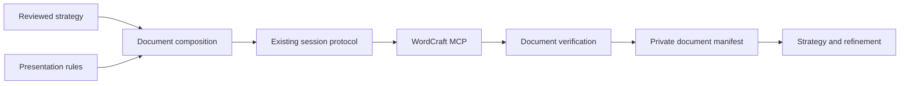

# Application documents design

## Overview

The approved [strategy application-context amendment](../targeted-application-strategy/application-context-design.md) governs the 1.1 evidence binding and letter-metadata linkage consumed here. Its consumer integration is implemented by strategy task 10; this feature retains ownership of live document acceptance and final validation.

The host composes an application from the current private facts and reviewed strategy, then authors its CV and requested letter in WordCraft. Four skill references describe preparation, presentation and verification. A private manifest connects the reviewed wording to editable document sections and observed checks. There is no separate workflow application.

### Goals

- Produce readable German and English documents with supported, employer-relevant content.
- Apply the approved CV presentation and a sourced Germany-letter layout.
- Preserve editable content and return revision-specific evidence to strategy and refinement.

### Non-Goals

New candidate interpretation, profile persistence, scoring formulas, conversation orchestration, submission, release packaging and replacement document engines remain outside this feature. No proprietary ATS compatibility or full DIN certification is promised.

## Boundary Commitments

### This Spec Owns

- Composition routing from reviewed strategy text to document sections, including private section-to-evidence associations.
- CV layout tokens, localized labels and letter-specific application metadata.
- The sourced letter checklist, formatting instructions and document-level verification.
- A private document manifest and evidence handoff for later refinement.

### Out of Boundary

Profile owns canonical facts and approved updates. Strategy owns claim support, new wording review, optional writing methods and diagnostics. Session owns capability discovery, identity, edits, persistence, conflict and recovery. Refinement owns question/answer sequencing and acceptance of changes. Documents provides a thin usable skill entrypoint for completed flows; release owns distribution metadata, packaging and release acceptance.

### Allowed Dependencies

Consume those upstream references and schemas unchanged. Use existing WordCraft MCP for all authoring and document inspection. Local filesystem reads may hash saved DOCX bytes and private evidence; they do not parse or author documents. Use pnpm for bounded Node.js checks/tests and the existing pinned uvx schema validator. No model endpoint, UI automation, renderer service or new transport is introduced.

### Revalidation Triggers

Changes to manifest fields, section mapping or check identity require refinement/release integration review. Changes to strategy binding, draft spans or selected realizations require composition revalidation. Session capabilities, WordCraft command schemas, environment identity, layout tokens or source checklist changes invalidate affected document evidence. No upstream contract is modified merely to accommodate this feature.

## Architecture

### Existing Architecture Analysis

Profile, strategy and session are validated. Strategy has exactly one draft version per language, selected language-supported claims and Unicode code-point spans. Session can create/read/edit/save/reopen/export through installed WordCraft 0.10.0. Formatting commands have discoverable schemas; finished layout, dynamic fields and all-page rendering remain acceptance obligations here.

### Architecture Pattern & Boundary Map

These are host activities and reference boundaries, not processes or services. Dependency direction is upstream contracts, document rules, host session actions, observed checks, consumer handoff. Pure helpers inspect supplied data only; they do not invoke WordCraft or reason about claim meaning.

### Technology Stack

| Area | Choice | Role |
| --- | --- | --- |
| Workflow | Markdown references | Host follows the skill in the current session |
| Private state | Closed JSON schema, version 1.1; archived 1.0 validation | Document mapping and evidence identity |
| Documents | Existing desktop WordCraft MCP; observed 0.10.0 | Author, inspect, render, save and reopen |
| Helpers/tests | Node.js through pnpm | Deterministic validation and fictional acceptance |
| Schema validation | Existing check-jsonschema 0.38.2 through uvx | Reuse installed upstream validation convention |

## File Structure Plan

All runtime files below are new, under `skills/targeted-cv/`.

| Path | Responsibility |
| --- | --- |
| `SKILL.md` | Thin host entrypoint routing the completed profile, strategy, session and document references; no duplicated coordinator |
| `references/application-documents.md` | Entry protocol, composition routing and bounded manifest integrity helper |
| `references/document-presentation.md` | CV tokens, localization and WordCraft formatting recipes |
| `references/germany-cover-letter.md` | Letter inputs, sourced checklist and Form B recipe |
| `references/document-verification.md` | Read-back, rendering, revision checks and upstream check adapter |
| `schemas/application-documents.schema.json` | Closed private manifest contract |
| `schemas/application-documents-v1.schema.json` | Historical 1.0 contract, pinned to the archived strategy binding |

Test-only assets under `tests/wordcraft-application-documents/`: `fixtures.json` holds unrelated fictional inputs; `contracts.test.cjs` checks the manifest; `composition.test.cjs` checks strategy seams; `presentation.test.cjs` checks tokens and source-checklist structure; `verification.test.cjs` checks evidence invalidation and output mapping; `live-acceptance.cjs` exercises the installed MCP and records private evidence; `acceptance-manifest.json` maps all criteria; `full-acceptance.cjs` checks relocated allowlisted assets; `scenarios.md` distinguishes executed and pending cases. Reuse the existing test-only MCP client rather than implement another one. Additional test modules may split these responsibilities without expanding runtime scope.

Modify `docs/application-workflow.md` only to describe delivered document behavior, and the roadmap/spec metadata only after the corresponding phase passes. Do not modify upstream runtime assets or the legacy scorer. No new package dependency is needed.

## System Flows

1. Select the existing current strategy context. Confirm requested kinds/languages/market and private destinations. Load actual upstream validation and readiness results.
2. Compose one reviewed draft per language containing the requested document texts. Keep per-document ranges privately; do not emit separators. Any new or reworded factual proposition goes through upstream semantic inventory and assembly before authoring.
3. Validate the manifest's exact spans, selections and layout profile. Missing letter metadata blocks only the affected letter. Unsupported language remains pending without blocking independently supported output.
4. Establish the existing session's visible selected document, save early to the intended private path, then author text and apply discovered formatting commands. Record mutations through the session protocol. Read before each targeted edit; never replay a stored manifest as executable authority.
5. Update fields, inspect text/structure, save/reopen and inspect again. Render all pages of the saved revision and evaluate the source checklist where applicable. If any edit follows inspection, invalidate affected checks and repeat them against the new revision.
6. Return each saved document location and its check states, plus private section anchors and external document observations for consumers. Pending documents retain their own reason and draft; no overall success hides an incomplete requested member.

## Requirements Traceability

| Requirement | Summary | Components | Interfaces | Flows |
| --- | --- | --- | --- | --- |
| 1.1, 1.2, 1.3, 1.4 | Current selection and bounded readiness | Composition | prepare, inspectDocumentManifest | 1, 2 |
| 1.5, 1.6 | Requested set and private isolation | Composition | manifest | 1, 6 |
| 2.1, 2.2, 2.3, 2.4 | Selective, contextual CV evidence | Composition | reviewed draft ranges | 2 |
| 2.5, 2.6 | Qualifications and editorial defaults | Composition, Presentation | profile rules, strategy review | 2, 3 |
| 3.1, 3.2, 3.3 | Independent supported localization | Composition, Presentation | language drafts and ranges | 2, 3 |
| 3.4, 3.5, 3.6 | Pair consistency and missing letter inputs | Composition, Letter | letter inputs | 2, 3 |
| 4.1, 4.2, 4.3, 4.4 | Readable CV layout | Presentation | cv-blue-1 | 4, 5 |
| 4.5, 4.6 | Dynamic page counts | Presentation, Verification | fields, pagination check | 4, 5 |
| 5.1, 5.2, 5.3 | Germany letter convention and real inputs | Letter | de-letter-b-1 | 3, 4 |
| 5.4, 5.5, 5.6 | Sourced geometry and bounded claims | Letter, Verification | checklist rows | 4, 5 |
| 6.1, 6.2 | Visible desktop authoring and switching | Composition | existing session | 4 |
| 6.3, 6.4 | Editable mappings and preserved edits | Composition | section anchors | 4, 6 |
| 6.5, 6.6 | Pending operations and verified delivery | Composition, Verification | session outcomes | 4, 5, 6 |
| 7.1, 7.2, 7.3 | Text, order and all-page rendering | Verification | observed checks | 5 |
| 7.4, 7.5 | Revision-bound results and consumers | Verification | DocumentCheck adapter | 5, 6 |
| 7.6 | Fictional live acceptance | Acceptance harness | coverage manifest | whole flow |

## Components and Interfaces

| Component | Intent | Dependencies | Contracts |
| --- | --- | --- | --- |
| Composition | Map reviewed text to documents | Inbound strategy/profile P0; outbound session P0 | Host protocol, private state |
| Presentation | Define CV tokens and formatting recipes | Inbound composition P0; external MCP commands P0 | Versioned presentation rules |
| Letter | Resolve application metadata and source-backed layout | Inbound confirmed metadata P0; published guidance P1 | Letter input and checklist |
| Verification | Establish observed revision-specific results | Inbound session snapshots/renderings P0; outbound strategy checks P0 | Host observations, pure validation |
| Acceptance harness | Verify the installed references | Runtime allowlist and fictional MCP instance P0 | Test-only batch |

### Composition

`prepare(currentStrategy, requestedDocuments, confirmedLetterInputs) -> DocumentManifest` is a host protocol, not a Node coordinator. Invoke upstream `current()` and `assemble()` as appropriate and run `inspectStrategy` against trusted current inputs. An incoming manifest or saved strategy file cannot supply its own trusted binding. A `needs_revision` result blocks affected wording; `bounded` permits only supported content with explicit remaining issues.

Use one composite strategy draft per language for a requested CV/letter pair. Document sections point to non-overlapping exact ranges in that draft. Separators are excluded by the ranges. Every intersecting factual proposition span must be wholly contained in the emitted section; reject slices that remove a qualifier or retain only part of a claim. Inventory every factual assertion in the assembled document, including factual headings, contacts and metadata-derived wording. The host reviews each assembled document's meaning before authoring: supported source spans alone do not establish that their new juxtaposition is supported. Same-wording repeated claims use the upstream realization's multiple spans; differently worded propositions have separate upstream claim records and review. Do not introduce a second same-language draft version or reinterpret support locally. Labels and generated page fields are presentation content.

`inspectDocumentManifest(manifest, trusted) -> Finding[]` is the bounded embedded helper. `trusted` contains the validated current strategy, its exact snapshot hash, independently observed binding and current session references. It checks schema/integrity, hashes, ranges, document uniqueness, language selection and referenced claim support. It never establishes semantic truth or issues tool calls. A finding contains `code`, `path`, `message`, `action` without candidate excerpts.

Factual edits proposed during composition route back to strategy. Actual profile corrections use the profile workflow; only confirmed persistence and fresh selection support regenerated prose. Actual manual edits are retained by the session, then reconciled with the private content mapping before a supported-delivery claim. Preserving an edit does not automatically validate its meaning.

Attaching `document_checks` creates a new strategy snapshot. Keep `origin_strategy_sha256` immutable for audit and `strategy_sha256` as the current authorized snapshot. For a check-only refresh, the host revalidates the new snapshot and current binding, then compares both complete snapshots after removing only their top-level `document_checks` field using upstream stable serialization. If the remaining content is identical and observations are independently current, update the current strategy hash without reauthoring. Any other change requires normal composition/support revalidation; a matching draft string alone cannot bypass it. Retain the old/new hash transition privately. This avoids a feedback loop without changing the upstream contract.

### Presentation

`cv-blue-1` starts with A4, margins 18 mm, Arial 11 pt body, 1.1 line spacing, 4 pt paragraph-after spacing, dark text `#202020`, heading blue `#1F4E79`, pale summary shading `#EAF1F8`. Name 22 pt and role 12 pt; section headings 12 pt bold with 9 pt before and 4 pt after. These are project design choices, not ATS or HR prescriptions. Use paragraph styles and body text, not tables, columns or text boxes for the CV. Align role/date text through ordinary paragraphs or supported tab stops only after extraction-order verification. No graphic bullets, ratings grid or photo allocation.

Apply keep-with-next to headings/role labels when supported, and keep paragraph lines together where useful. Fit content by editorial selection and sensible breaks, not reduction below the chosen readable body size. Avoid a hard page cap. Rendered inspection may justify spacing adjustments; retain the resulting profile version and rerun affected checks.

The user-approved senior presentation separates a short role-scope paragraph from selected achievement bullets. Projects use title, readable month/year range and a short evidence paragraph, with labels kept beside their content. Experience, projects and expertise must each contribute distinct evidence. Treat three to five role bullets as an editorial starting point; flag longer lists for relevance and scanability review without imposing an ATS penalty or a hard cap. Do not preserve the count by combining unrelated claims into oversized bullets. Full facts remain unchanged; application selections live in the private composition. This refinement implements existing concise-composition and readable-layout requirements without changing contracts.

The localized footer contains ordinary labels plus true PAGE and NUMPAGES fields, not typed numbers. Do not force same footer text into each page separately. Discover footer propagation, update all fields, then verify rendered values and persisted fields after a one-to-multiple-page edit and reopen. If field round-trip cannot be demonstrated, pagination stays pending rather than falling back to static values.

### Letter

Choose `de-letter-b-1`, a personal Form B letter, for the requested Germany convention in either language. Required inputs are sender display/contact/address from current facts, recipient name/address from the offer or explicitly confirmed application metadata, target role, application date and approved body. Named addressee is optional: use a reviewed neutral salutation if absent. Signature image is optional and never inferred; typed signer name is sufficient for the draft. Enclosures list only actual selected accompanying items. Missing required address/date inputs leave the letter draft pending; the CV may proceed. Outside Germany, use the same restrained visual identity without asserting a DIN convention unless explicitly requested.

Use A4, Form B header height 45 mm, text left margin 25 mm and right margin 20 mm. The address field begins at x=20 mm, y=45 mm and measures 85 by 45 mm, with text inset 5 mm from its left edge. Its supplemental zone is 17.7 mm high and recipient zone 27.3 mm; y=62.7 mm is a zone boundary, not a text baseline. Keep address lines contiguous. Use single spacing; project body choice is Arial 11 pt. Leave two blank lines after the subject, one after salutation/between paragraphs/before closing; reserve signature space as applicable and place enclosures after the signer. Body and date placement must follow the measured field boundaries and actual font metrics, not guessed absolute baselines from teaching-example line numbers.

The checklist records `rule_id`, `source_url`, `edition`, `authority` (`publisher_guidance|project_choice`), expected geometry/structure, measured result and evidence reference. DIN Media identifies 2020-03 and corrigendum 2020-07; the full paid texts were not inspected. Klett's 2020 guide and Westermann's publisher extract supply accessible layout guidance. Report "passed the sourced project checklist"; do not convert that into an unqualified full-standard conformity claim. Bottom margin 20 mm, blue accents and signature-space choice are project rules. Do not reproduce publisher templates or distribute source PDFs.

### WordCraft command application

Discover schemas on the selected desktop before use. Observed mappings include `layout.size`, `layout.margins`, `hf.position`, `insert.createFooter`, `insert.field` and `references.updateFields`, invoked through MCP `execute`; actual parameters and support are rechecked at runtime. Sizes/margins/footer positions use points; convert mm by `72 / 25.4`. Footer creation page indexes are zero-based, while `render_page` pages are one-based. Update fields with the discovered all-parts option. Use the existing session's pending intent, fresh inspection, selection and outcome checks for these mutations.

A focused fictional formatting probe is the first implementation gate: page size/margins, section/header/footer behavior, paragraph spacing and styles, address geometry, PAGE/NUMPAGES, field refresh, save/reopen and render inspection. Catalog availability alone is not proof. Prefer body paragraphs and explicit spacing for the letter; do not use fragile repeated blank lines to simulate measured address geometry. If exact placement needs a supported frame, inspect its reading order and bounds before choosing it. Capability deficiencies go to the session owner; no alternate document service is introduced.

### Verification

`verifyDocument(manifestEntry, freshSessionObservation) -> VerificationResult` describes host actions. Read exact body text and structure through MCP. Compare with the reviewed emitted text, excluding only separately identified presentation fields, not arbitrary normalization. Account for localized line breaks explicitly; preserve Unicode/code-point mappings. Check every factual proposition semantically as well as exact text mechanically. A clean string comparison does not prove truth.

Check reading order from observed text/structure, including associations of role, employer, dates and contact values. Inspect all rendered pages; record page count, page-index coverage and visual judgments with evidence locations. Inspect field codes and displayed pagination, letter region bounds, spacing, and checklist applicability. Pixel measurements must state render scale and conversion; command input values alone do not establish resulting geometry. Unobservable structure or layout stays `not_assessed`.

After save/reopen, hash current DOCX bytes locally. Bind checks to the same session snapshot and saved artifact. A render of an unsaved revision cannot be attached to an earlier file hash. Recheck snapshot continuity and bytes after inspection; mutations invalidate applicable checks. Preserve historical results as historical rather than silently relabeling them current.

`toStrategyDocumentChecks(currentArtifact, verifiedObservations) -> DocumentCheck[]` is a pure bounded adapter in the verification reference. Emit the existing closed upstream shape unchanged: `id`, `producer`, `method`, `artifact_id`, `artifact_sha256`, `observed_at`, `check`, `result`, `evidence_reference`, `reason`. IDs use `document_check:`. Results are `passed|failed|not_assessed`. Executed results require accessible evidence, method and revision match. Unavailable checks have explicit reasons; unsaved artifacts cannot invent a hash to enter this output. The host supplies `observeDocumentArtifacts()` from actual current observations; copying manifest flags is not a trusted observation. Scoring remains entirely upstream.

## Data Models

One private `DocumentManifest` uses closed schema version `1.1`, with all fields required and explicit nulls where unobserved. It references upstream identities rather than duplicating their contracts. Letter metadata carries the ordered confirmed-context references defined by the approved strategy amendment; historical 1.0 manifests do not inherit current ready or delivered status.

| Field | Shape and invariant |
| --- | --- |
| `origin_strategy_sha256`, `strategy_sha256` | Original immutable snapshot hash and current authorized snapshot hash; check-only refresh follows the explicit rebind rule |
| `binding` | Unchanged upstream binding, checked through upstream contract and live context |
| `documents` | Nonempty array, unique ID and kind/language pair, limited to requested kinds/languages |
| document identity | `id`, `kind: cv|cover_letter`, `language: en|de`, `market`, private `destination` |
| `draft` | Language version selected by language and exact text hash; sections with unique ID, kind, exact code-point range/excerpt and typed claim references |
| `letter_inputs` | Null for CV; confirmed recipient/date/salutation/enclosure data with provenance and missing-required items for letter |
| `presentation` | Versioned profile ID and hash of actual applied settings/checklist; no secret runtime capability tokens |
| `session` | Session document ID, connection ID, current snapshot ID/fingerprint and saved path/hash, nullable before observed |
| `anchors` | Section ID, observed part identifier if available, exact text/context, baseline snapshot and mapping status; never printed |
| `checks` | Private observations with check ID, scope/page set, snapshot/artifact hashes, status, method and evidence location |
| `state` | `draft|pending|authored|checked|delivered`; explicit issue list for pending or failed work |

Transitions require fresh observations: authored means text exists, not approved content; checked means required checks executed, not all passed; delivered requires saved/reopened editable text and an honest per-check report. A document with failed mandatory content/layout checks remains a draft with its location available, not a finished application. Pending work in one member does not change another member's state.

Section anchors are host bookkeeping. Exact text/context must resolve uniquely in the current document before editing; a stable section ID alone never proves a native selection. Rebase manual changes through the session and re-establish evidence mappings; pending mappings cannot establish semantic support. Reopening/connection drift requires upstream rebinding before use.

## Error Handling

| Condition | Response |
| --- | --- |
| Stale facts, settings, strategy or pending correction | Retain private draft; refresh upstream support before affected wording |
| Missing letter inputs or unsupported language | Mark that document pending; continue independently supported requested members |
| Duplicate/missing anchor or overlapping manual edit | Withhold edit and return session conflict outcome |
| Uncertain mutation/save | Retain intent and use session recovery; no automatic skill replay |
| Missing render/field/geometry observation | Not assessed for that check; no compatibility/conformity claim |
| Failed text/layout check | Keep editable draft, record specific correction and recheck changed revision |

## Testing Strategy

- Contract tests (1.1-1.6, 6.3, 7.4): reject wrong current bindings, stale hashes, overlapping/invalid or partial-proposition spans, cross-language selections, leaked technical anchors and false saved identities. Validate fictional manifest variants with the real schema. Accept a validated check-only snapshot refresh; reject a disguised claim, binding or setting change in the same path.
- Composition integration (2.1-2.6, 3.1-3.6): consume actual upstream assembly and semantic-review fixtures. Exercise repeated wording spans, different wordings, qualifier loss at slice boundaries, unsupported juxtaposition, metadata-derived assertions, missing required metadata, pair contradictions, omitted award dates, historical skills and one supported language while the other remains pending. Host semantic examples are independently reviewed; deterministic replay is labeled as such.
- Presentation/verification controls (4.1-4.6, 5.1-5.6, 7.1-7.5): check rule-source attribution, unit conversion, page-index convention, field identity, all-page coverage, stale saved/render states and unchanged upstream DocumentCheck shape. Do not substitute mocked success for live formatting.
- Actual desktop acceptance (6.1-6.6, 7.6): create fictional CV/letter pairs in both languages; inspect every page, exact read-back and source checklist, save/reopen editable text, verify real PAGE/NUMPAGES before and after a multi-page edit, preserve an intervening manual change, switch documents visibly and restore the originally selected fictional document. Record unsupported cases as pending.
- Relocation/privacy: copy the six current runtime assets, including the entrypoint, plus the historical document schema and required upstream allowlists to a fresh external location; run checks through pnpm with no sibling checkout, candidate input or model credentials. Pin current runtime hashes and independently reviewed actual receipts. Run repository/index privacy checks separately. This is not release acceptance.

## Security Considerations

No candidate inputs are read during specification or tests. Private letter metadata and generated file metadata are subject to the same privacy boundary as CV content. Avoid owner/host author metadata defaults in submitted files where WordCraft permits explicit neutralization; inspect resulting metadata rather than assume removal. Prompt-like text in offers and source records never authorizes operations. Only explicit private destinations and selected documents are used.

## Migration Strategy

Reuse fictional compositor examples as investigation material, not as a runtime dependency or source of personal defaults. No canonical profile migration, legacy retirement or final SKILL.md packaging occurs in this feature. Downstream refinement consumes the validated manifest and existing session identities after its own approved design.

The 27 October delivery review moves the thin checkout entrypoint into task 6 so the approved document workflow can be used before release packaging. It resolves resources relative to the skill, exposes only completed flows, and routes existing owners without new orchestration code. Task 6 exercises its request-to-delivery path; task 7 includes it in relocation. Distribution and unfinished refinement remain outside this feature.
