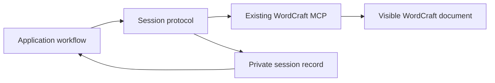
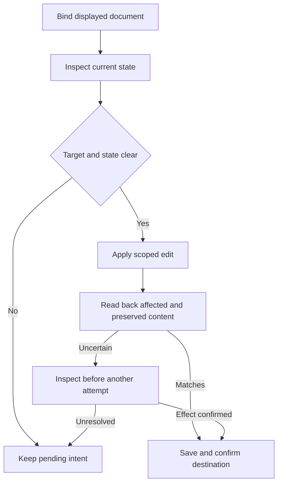

# Document session design

## Overview

The skill operates on the visible WordCraft document through the existing desktop-connected MCP server. It reads the current document, applies a small requested change, reads it again and saves the result. CV composition, cover-letter wording and factual questions are supplied by the adjacent application workflows.

Installed WordCraft 0.10.0 has demonstrated this ordinary lifecycle with fictional CV and letter content. The design adopts that interface without a new service, transport, WordCraft fork or UI-automation dependency. Remaining acceptance tests concern the reusable protocol and its failure paths, not permission to use the working interface.

### Goals

- Maintain an identifiable document across live edits and persistence.
- Preserve observed manual changes and report what each executed check establishes.
- Retain pending work when a particular operation cannot be verified.

### Non-Goals

Candidate intake, employer analysis, document styling, DIN layout, diagnostic scoring, question sequencing and release packaging remain with their owning features. This feature does not promise atomic protection against simultaneous typing or exactly-once delivery inside WordCraft's transport.

## Boundary Commitments

### This Spec Owns

- A portable instruction protocol for MCP capability discovery, document binding, controlled changes, persistence and recovery.
- The private session record and operation evidence consumed by application and refinement workflows.
- Fictional acceptance fixtures and test-only MCP harnesses.

### Out of Boundary

No candidate facts are stored in reusable assets or implicitly written back to the canonical profile. No WordCraft source changes, custom servers, alternative document services, UI automation, model endpoints or maintained Python application are introduced. Test harnesses are not the shipped skill runtime.

### Allowed Dependencies

The host provides tool discovery and calls to existing WordCraft MCP, private state storage, and ordinary local application launch when needed. The official desktop/CLI installation is a runtime prerequisite. Host reasoning compares requested and observed meaning. The document layer passes already composed content; the session does not import the strategy schema or own its editorial decisions.

### Revalidation Triggers

Revalidate capability evidence when server version, tool schemas, connection mode or installed executable changes. Rebind documents after reopening, reconnecting or changing the active document. Any mutation invalidates previous document-state checks. Contract changes require downstream document and refinement review.

## Architecture

### Existing Architecture Analysis

Portable profile and strategy references already separate reusable instructions from private runtime records. Follow that pattern. The experimental fictional client demonstrated ordinary MCP calls but is not a production session coordinator and must not be shipped as one.

### Architecture Pattern & Boundary Map



Dependency direction: closed record schema, then capability and operation references, then the session entry reference. Tests consume those assets. The entry coordinates host reasoning and MCP calls; it is not an additional application or transport.

### Technology Stack

| Layer | Choice | Role |
| --- | --- | --- |
| Authoring and inspection | Existing WordCraft desktop and CLI MCP; 0.10.0 observed | Sole document interface |
| Skill runtime | Markdown references and JSON Schema 2020-12 | Host-executed protocol and private record validation |
| Verification | Small test-only Node.js helpers run through pnpm; pinned existing schema validator via uvx | Deterministic contract and synthetic MCP tests |

Desktop setup uses the documented `wordcraft --control <port>` and `wordcraft-cli mcp --connect 127.0.0.1:<port>` invocations. Resolve actual executable locations at runtime. Plain `wordcraft-cli mcp` is headless and does not meet live-authoring acceptance. No persistent host configuration changes are necessary for a session-local connection.

## File Structure Plan

| Action | Path | Responsibility |
| --- | --- | --- |
| Create | `skills/targeted-cv/references/document-session.md` | Entry protocol and downstream handoff |
| Create | `skills/targeted-cv/references/wordcraft-capabilities.md` | Discovery, desktop connection and evidence statuses |
| Create | `skills/targeted-cv/references/wordcraft-operations.md` | Binding, edit, persistence, inspection and recovery rules |
| Create | `skills/targeted-cv/schemas/document-session.schema.json` | Closed private record contract |
| Create | `tests/wordcraft-document-session/fixtures.json` | Entirely fictional document contents and expected edits |
| Create | `tests/wordcraft-document-session/contracts.test.cjs` | Schema, transitions, evidence freshness and invalid inputs |
| Create | `tests/wordcraft-document-session/protocol.test.cjs` | Scripted host/MCP observations for conflicts and uncertainty |
| Create | `tests/wordcraft-document-session/live-acceptance.cjs` | Explicitly selected real MCP session; lifecycle receipts |
| Create | `tests/wordcraft-document-session/scenarios.md` | Exact acceptance procedures and scope of evidence |
| Modify | `docs/application-workflow.md` | Brief user-facing document flow |

The existing bridge replay probe remains historical discovery evidence, outside the feature's pass/fail acceptance suite. The final skill entrypoint and archive allowlist belong to release work. Real documents and logs stay in explicitly selected private destinations or ignored outputs.

## System Flows



At initial authoring, launch the desktop visibly if required and connect MCP to that instance. Use only capabilities discovered in its catalog for selecting or displaying documents. If an existing minimized instance cannot be raised through the available launch/MCP controls, ask the user to bring it forward once; do not introduce UI automation or claim foreground success without evidence. Later user focus changes do not trigger repeated activation. Each document/language switch identifies the document in the host response and explicitly selects it through MCP.

## Requirements Traceability

| Requirement | Summary | Components | Interfaces | Flows |
| --- | --- | --- | --- | --- |
| 1.1, 1.2, 1.3, 1.4, 1.5 | Discover usable operations and verified setup | Capability protocol | discover | Connect |
| 2.1, 2.2, 2.3, 2.4 | Establish and maintain identity | Operation protocol | bind, inspect | Bind/read |
| 2.5, 2.6 | Confirm persistence | Operation protocol | persist | Save/reopen |
| 2.7 | Visible desktop authoring | Capability and session protocols | discover, bind | Connect/switch |
| 3.1, 3.2, 3.3, 3.4, 3.5 | Scoped edits and preservation | Operation protocol | edit, inspect | Read/edit/verify |
| 4.1, 4.2, 4.3, 4.4 | Detect intervening changes | Operation protocol | edit | Compare/pending |
| 5.1, 5.2, 5.3, 5.4, 5.5, 5.6 | Uncertainty and reconnect | Operation protocol | reconcile, bind | Recover |
| 6.1, 6.2, 6.3, 6.4, 6.5 | Bounded inspection evidence | Record contract and operation protocol | inspect | Verify |
| 7.1, 7.2, 7.3, 7.4, 7.5, 7.6, 7.7 | Synthetic acceptance and honest status | Acceptance harness | live and protocol scenarios | Whole flow |

## Components & Interfaces

These are host protocol operations, not invented WordCraft tool names or a new executable service. Each resolves to discovered MCP tools. Inputs and results are validated before they enter the private record.

| Component | Intent | Dependencies | Contracts |
| --- | --- | --- | --- |
| Capability protocol | Describe actual operation support | External WordCraft MCP, blocking | Service and state |
| Operation protocol | Act on selected documents and verify effects | Capability record and MCP, blocking | Service and state |
| Session protocol | Route requests and retain pending work | Operation protocol and private storage, blocking | Service and state |
| Record contract | Keep evidence attributable to a document state | JSON validator, blocking for persisted records | State |
| Acceptance harness | Exercise the shipped instructions and live tools | Runtime assets and selected MCP instance, blocking for acceptance | Test batch |

### Capability protocol

`discover(connection) -> CapabilityReport`

Capture server identity/version when available, desktop/headless mode, tool names and input-schema fingerprints. Report each of create, open/select, read, targeted edit, save, reopen, DOCX export, render and extraction independently as `demonstrated`, `failed_or_unsupported`, `unavailable` or `unverified`. Demonstrated entries require an executed receipt, format and environment binding. Discovery alone is not demonstration; historical headless evidence cannot authorize desktop identity claims.

Observed tool mappings: `new_document`, `open_document`, `get_text`, `inspect_document`, `select_text`, `type_text`, `save_document`, `render_page`. Discover command-specific schemas through `list_commands` before using `execute`. A catalog hint does not determine whether a call has effects. Do not rely on transactional `batch` semantics. Block only the operation whose required capabilities are missing.

### Operation protocol

`bind(selection) -> Outcome<DocumentBinding>` accepts an explicit existing path or a new-document request. Record connection/session identity, host logical document ID, kind, language, current path, and native document ID only if actually available. Logical IDs are bookkeeping, not proof of native identity. Initially unsaved documents are bound only to the current connection and observed active state. Save to the selected unique private destination early. Before switching, save current work or obtain a user decision about unsaved work; never silently discard it.

`inspect(binding, checks) -> Outcome<Snapshot>` uses MCP text and structure. A snapshot contains exact text, normalized relevant structure, selection/parts needed for the target, and fingerprints. Native paths/identifiers returned by MCP support identity; a title or matching text alone cannot distinguish identical documents. Where path is not exposed during inspection, retain the confirmed open/save receipt plus uninterrupted connection and current-state continuity. If those conditions cannot establish identity, stop the edit and explicitly reselect. Reopening a saved file cannot silently replace unsaved work.

`edit(binding, intent, baseline) -> Outcome<Snapshot>` checks the current document and compares it with the baseline before selecting text. An intent specifies exact target text with context/part, replacement or discovered formatting command, and permitted scope. Count matches; never silently take the first of duplicates. Verify the actual selection through MCP inspection before mutation. Missing, ambiguous or changed targets become pending work. Changes outside the target are retained by rebasing onto the current snapshot. Overlapping changes require the user's decision.

After mutation, read the text and structure again. Compare the expected target change and all inspected out-of-scope content/formatting. An uninspectable preservation property remains not assessed and blocks an edit that needs that property guaranteed. Never regenerate the entire file to repair a local edit. Unexpected differences become a conflict; preserve current work and do not automatically undo intervening user changes. Short sequential calls reduce interference but are not atomic.

`persist(binding, destination, format) -> Outcome<ArtifactReceipt>` calls `save_document` with the actual destination/format. Preserve in-place identity for ordinary saves; explicit export creates an artifact relationship, not an unrelated document binding. Confirm the returned path and success result, then reopen/read via MCP when round-trip verification is requested and unsaved-work handling permits it. A failed reopen does not erase a confirmed save, but the round-trip check fails. DOCX export is demonstrated only for the tested DOCX path/format; do not infer PDF support.

`reconcile(binding, pending) -> Outcome<Snapshot | ArtifactReceipt>` first restores connection and identity, then inspects whether the intended effect occurred. If confirmed, report recovered success without repeating it. If absent is conclusively established, revalidate current target and authorization before a new attempt. Unknown state retains the intent and withholds another attempt. Any create/edit/save/export timeout after dispatch is uncertain. Known pre-dispatch validation failure is failed without an effect. External internal retries remain outside the skill's exactly-once claims.

### Session protocol and record contract

`handle(request, record) -> {record, outcome}` routes one operation at a time. Requests contain a selected document and content intent, never implicit candidate defaults. Confirmed profile corrections are handed back to the owning application workflow; session code cannot write the facts file. Before dispatching any mutation, persist its pending intent and baseline in the selected private session record; append the outcome receipt afterward. If pending-state persistence fails, do not dispatch. Resume uses the private record only to recover intent, then obtains fresh MCP identity/state before writing.

All operation outcomes use a discriminated union:

```typescript
type Outcome<T> =
  | { status: 'confirmed'; value: T; evidenceIds: string[] }
  | { status: 'pending'; reason: 'selection' | 'conflict' | 'capability'; intentId: string; nextAction: string }
  | { status: 'uncertain'; intentId: string; evidenceIds: string[]; nextAction: string }
  | { status: 'failed'; code: string; message: string; evidenceIds: string[] };
```

The schema closes every record object and defines `schema_version`, connection/capabilities, document bindings, snapshots, intents, operation receipts and checks. IDs must be unique and references resolve within the record. Every check binds document ID, snapshot fingerprint, producer tool, executed time, scope, status and evidence. Status is `passed`, `failed` or `not_assessed`; evidence from older states is retained but marked stale. A screenshot never establishes parser compatibility. Presentation and semantic quality remain downstream judgments.

### Acceptance harness

The test runner requires an explicit fictional fixture and desktop MCP endpoint. It never opens a personal facts file or falls back to headless mode to satisfy live acceptance. Record the actual shipped reference/schema hashes, server identity, tool contracts, selected artifact and executed scenario outcomes. Mocks establish coordinator behavior only; live receipts establish external integration. Missing required scenarios prevent milestone acceptance.

## Data Models

Private session records are per application, with multiple document bindings for language and CV/letter variants. Snapshot content and paths are private data. Content fingerprints identify state, not a person or a native document. Pending intents remain recoverable after tool failure and carry their original baseline; successful reconciliation resolves them without losing the audit receipt.

No secrets, control keys or host installation paths are embedded in portable assets. Resolve setup locally and let the official CLI handle authentication. Saved records do not persist authentication material. Export destinations must be explicitly selected and collisions resolved before overwriting an unrelated file.

## Error Handling

Selection ambiguity requests the intended document. Target conflicts request a content decision. Missing capabilities identify only the affected operation. Access loss retains drafts and pending changes. Uncertain writes trigger inspection, not automatic replay. All user-facing explanations state what is needed to continue and avoid repeating transport research during normal editing.

## Testing Strategy

1. **Contract and capability cases (1.1 to 1.5, 6.1 to 6.5):** validate every status, missing evidence, stale snapshot, changed schema/version, invalid references and headless/desktop evidence separation. Checks read from the shipped references; fabricated receipts never count as live evidence.
2. **Lifecycle (2.1 to 2.7, 7.1, 7.7):** fictional CV and letter, selected private paths, live creation, unique targeted edit, MCP read-back, DOCX save/reopen, correct document on switching. Capture desktop-mode evidence through discovered MCP inspection/screenshot tools or explicit user confirmation of visibility; no external UI service. A headless run must fail live acceptance.
3. **Preservation (3.1 to 3.5, 4.1 to 4.4, 7.2):** duplicate/missing targets, nonconflicting edits retained, overlapping edits withheld, changed active document, unrelated formatting unchanged, and uninspectable state not falsely verified. Simulated manual changes use a separate test actor through MCP; label this as an intervening edit, not proof of simultaneous human typing safety.
4. **Recovery (5.1 to 5.6, 7.3):** test host-observed uncertainty after an actual synthetic effect, effect confirmed without another write, confirmed absence requiring fresh preconditions, unresolved state retained, and reconnect identity mismatch. Inject a dropped host response after a successful MCP call to exercise skill-level recovery without claiming to repair internal bridge delivery.
5. **Acceptance boundaries (7.4 to 7.6):** missing tool blocks dependent work, no substitute engine/service, wholly fictional fixtures, portable asset relocation and privacy review. Run the repository privacy checker before staging. Report any unexecuted live scenario as pending rather than passing it from mock results.

## Security Considerations

Use the official loopback authenticated connection; do not log or embed its key. Tool outputs, source documents and offers remain data, never instructions to execute arbitrary commands. Live tests use explicitly selected fictional documents and unique destinations. The skill cannot treat successful MCP access as permission to enumerate unrelated documents or filesystem content.
