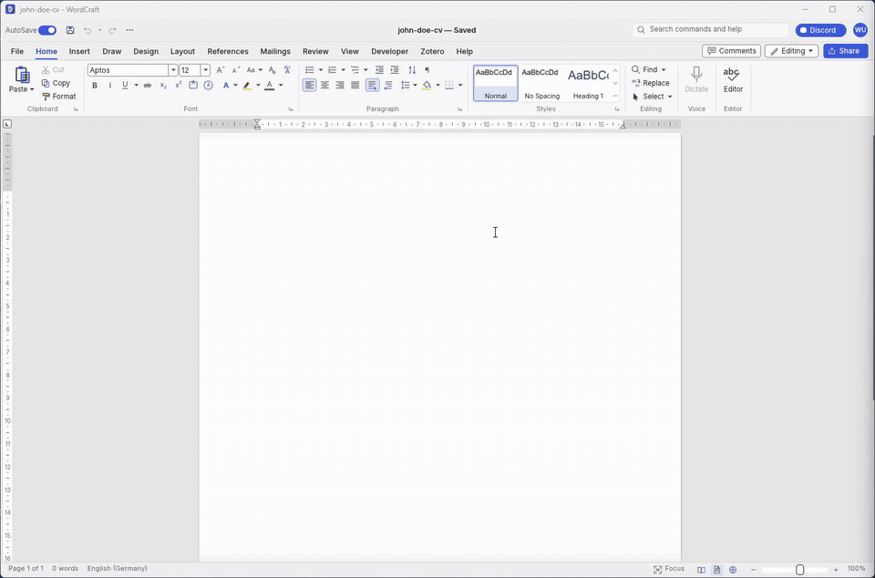
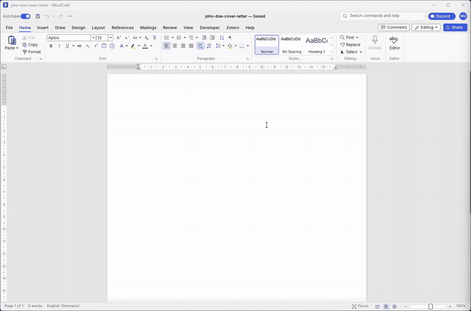

# Targeted CV

Turn your career history and a job offer into a focused CV and cover letter. Keep your facts in a private file, explain what you can contribute to the employer, and refine the documents in WordCraft.

Watch a fictional Men in Black application take shape in WordCraft. Each recording starts from an empty document and captures only the WordCraft window.

**Two-page CV**



**Cover letter**



## Start with your agent and WordCraft

This is an agent skill. Your AI host reads the instructions, works with your private facts and calls WordCraft's tools. You watch and edit the actual document in the desktop app.

Before your first application, you need:

- An AI host that supports local skills, file access and MCP tools.
- WordCraft desktop and `wordcraft-cli`, connected to that host through MCP.
- Node.js, pnpm and uv/uvx for the local deterministic checks. These helpers do not call model APIs.

Install the `targeted-cv` folder from the [latest alpha release](https://github.com/norandom/ats-agent/releases) in your host's skill directory, or load [SKILL.md](skills/targeted-cv/SKILL.md) from this checkout. Keep the folder's references, schemas and templates together.

Then [connect WordCraft once](docs/wordcraft-setup.md). The connection is:

```text
You and your AI host -> targeted-cv instructions -> WordCraft MCP -> open document
```

The host discovers WordCraft's available tools and uses them to write, read back, render and save your CV or letter. The skill does not start a background Node service. Dagger builds and checks the release; it is not part of your document session.

For your first run, ask: **“Use targeted-cv. Check my WordCraft connection, then help me prepare my private facts file.”** A successful connection check reads the selected document before authoring begins. The alpha supports document creation and bounded edits; the full conversational refinement loop is still planned. See the [roadmap](.kiro/steering/roadmap.md) for scope.

## 1. Prepare your facts once

Provide your existing CV or start with the [blank facts template](skills/targeted-cv/templates/cv-facts.blank.json). The agent organizes your experience, qualifications, projects and skills into a structured file for you to review. Unknown details stay unknown; you can fill them in later.

Keep this file private. It is the source for your applications, so you do not need to repeat your career history for every offer. See [Your facts file](docs/your-facts.md) for what belongs there and how corrections work.

## 2. Paste a job offer

Choose your facts file, paste the offer, and specify German or English. Also name the target country and whether you want a cover letter. Language and country are separate choices: an English application can target a German employer.

For example:

> Use my facts file at private/my-facts.json for the offer below. Prepare an English CV and a cover letter for Germany. Ask me about missing evidence before finalizing the documents.

Without an offer, you can name a target role and prepare a general version. Job-specific coverage needs an actual offer.

## 3. Strengthen the application together

The agent identifies what the employer needs, selects relevant experience and proposes a contribution argument. It asks focused questions about qualifications, responsibility or results that could make the application stronger.

You can answer, skip a question or confirm that you do not have a qualification. Missing information does not automatically mean missing ability. Reviews distinguish evidence coverage, claim support, employer appeal and readability so you can see what an edit improves.

## 4. Refine your documents in WordCraft

The agent opens WordCraft in the foreground and authors the CV and cover letter live through WordCraft MCP. You can watch each document take shape, review the wording and layout, and request changes to the same open application. The default CV uses blue accents, no photo and current-page/total-page footers. Degree and certification award dates are omitted by default; relevant expiry or in-progress status remains accurate.

For German-market cover letters, the workflow uses the requested DIN 5008 convention in either language. German and English versions draw on the same facts, with natural wording for each language.

## Optional writing skills

[COBESY](https://github.com/norandom/Skills/tree/main/cobesy), from the [Skills collection](https://github.com/norandom/Skills), helps organize the contribution argument and expertise section. [Humanizer](https://github.com/blader/humanizer) helps remove generic AI phrasing while preserving your meaning.

The workflow uses them when available. If either is missing, it offers a choice: help install it, let you install it yourself, or continue with the built-in writing guidance. It does not require you to install an entire marketplace. See [Writing skills and setup](docs/writing-skills.md).

## Your information stays separate

Your facts describe your career. Each application separately holds its offer, selected evidence, drafts and review notes. An edit to one CV does not silently change your reusable facts.

In this checkout, keep facts and offers in ignored `private/`, personal reference documents in ignored `examples/`, and generated documents in ignored `outputs/`. Git ignore prevents ordinary tracking; it does not make connected services local or stop deliberate sharing. Only provide candidate content to the host and document tools you have chosen to use.

Read [the application workflow](docs/application-workflow.md), [the research behind it](docs/recruiting-signals-2026.md), or [the requirements](.kiro/specs/targeted-application-strategy/requirements.md). The [fictional demo](tests/fantasy-cv/README.md) shows the document direction without using a real candidate's data.
